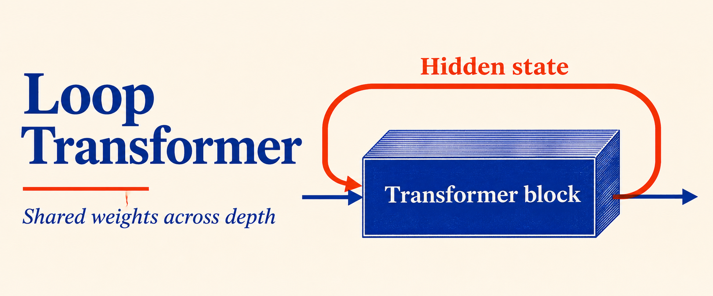

<h1 align="center">
  awesome-Loop-Transformer
  
</h1>

  
  

An annotated bibliography of Transformers that reuse parameters across depth. The core collection follows three research questions. What computations can a shared block learn? How should a model allocate additional passes? How do the resulting gains compare at fixed parameter count, executed depth or compute budget? A companion index covers recurrence across tokens, iterative decoding and feedback between model calls.

## Contents

- [Definition and notation](#definition-and-notation)
- [Historical development](#historical-development)
- [Selected readings](#selected-readings)
- [Model weights](docs/models-and-weights.md)
- [Model architecture figures](docs/model-architectures.md)
- [Research collections](#research-collections)
- [Bibliography and contributions](#bibliography-and-contributions)

## Definition and notation

A **Loop Transformer** (also called a *looped* or *recurrent-depth Transformer*) applies the same Transformer block, or stack of blocks, repeatedly to an evolving hidden state. Each pass receives the state produced by the previous pass. In a language model, several such updates can happen while the token prefix stays fixed, before the model predicts the next token. [Universal Transformers](https://arxiv.org/abs/1807.03819) · [Huginn](https://arxiv.org/abs/2502.05171)

Write the recurrent update as $h^{(t+1)} = F_\theta(h^{(t)})$, where $h^{(t)}$ is the sequence of hidden states after pass $t$ and $\theta$ is shared across passes. A core containing layers A and B, applied three times, executes **A → B → A → B → A → B**. That is six layer applications with two sets of layer weights. On its second visit, A receives the representation that B just updated. The model may also have input and output layers that run only once. [Recurrently stacked translation models](https://arxiv.org/abs/1807.05353) · [Huginn model card](https://huggingface.co/tomg-group-umd/huginn-0125)

**Depth schedule.** An architecture can prescribe a fixed number of passes, a caller can select a budget for a trained checkpoint, or the model can learn when each position should exit. Parameter sharing controls the number of distinct weights. The pass count controls how often those weights are used. [ALBERT](https://arxiv.org/abs/1909.11942) · [Huginn](https://arxiv.org/abs/2502.05171) · [Mixture-of-Recursions](https://arxiv.org/abs/2507.10524)

## Historical development

| First public release | What changed |
| --- | --- |
| 2016–17 · Two ingredients | Graves’s Adaptive Computation Time let an RNN learn how many internal updates to spend on an input. The original Transformer processed token positions in parallel using a stack of attention and feed-forward layers. The Universal Transformer later brought adaptive halting into that architecture. [ACT](https://arxiv.org/abs/1603.08983) · [Attention Is All You Need](https://arxiv.org/abs/1706.03762) · [Universal Transformer, §2](https://arxiv.org/html/1807.03819v3) |
| July 2018 · Two motivations | Dehghani et al. studied whether repeatedly updating every position helps with tasks such as copying and logical inference. The same month, Dabre and Fujita asked how much translation quality survives weight sharing. On their translation experiments, one layer used six times gave quality comparable to six separate layers. [Universal Transformers](https://arxiv.org/abs/1807.03819) · [Recurrent Stacking of Layers for Compact Neural Machine Translation Models](https://arxiv.org/abs/1807.05353) |
| 2019 · Sharing during pretraining | ALBERT used cross-layer sharing in a BERT-style encoder. Its ablations are worth reading because the model also changes the embedding parameterization. [ALBERT](https://arxiv.org/abs/1909.11942) |
| 2023–25 · Learning an update and spending more steps | Yang et al. studied what a shared update learns on in-context data-fitting tasks. Geiping et al. later pretrained Huginn, a 3.5B language model whose recurrent core can run for different numbers of steps at inference. [In-context learning study](https://arxiv.org/abs/2311.12424) · [Huginn report](https://arxiv.org/abs/2502.05171) |

## Selected readings

The sequence follows the evidence from architectural design to learned algorithms, inference-time scaling, interpretability and training cost. Years below refer to the first public release.

1. **Architecture · Dehghani et al. (2018).** Figure 2 of *Universal Transformers* shows both axes of computation. Attention exchanges information across positions, while the shared block updates each position across depth. The adaptive variant learns when a position can stop. [Paper and figure](https://arxiv.org/html/1807.03819v3)
2. **Algorithm learning · Yang et al. (2023).** *Looped Transformers are Better at Learning Learning Algorithms* tests whether sharing an update across depth helps with in-context data fitting. The linear regression experiments make the supervised target, prediction error and comparison to untied layers explicit. [Paper](https://arxiv.org/abs/2311.12424) · [Experiments](https://github.com/Leiay/looped_transformer)
3. **Inference-time depth · Geiping et al. (2025).** *Scaling up Test-Time Compute with Latent Reasoning* varies recurrence on a single Huginn checkpoint. The released model exposes `num_steps`, so accuracy and latency can be compared at two depths with prompts and decoding held fixed. [Paper](https://arxiv.org/abs/2502.05171) · [NeurIPS proceedings](https://proceedings.neurips.cc/paper_files/paper/2025/hash/3b01972cf31e6fa0fe29e4b8b5c2a0a1-Abstract-Conference.html) · [Checkpoint](https://huggingface.co/tomg-group-umd/huginn-0125)
4. **Interpretability · Lu et al. (2025).** *Latent Chain-of-Thought?* probes intermediate arithmetic results in Huginn. Comparing Logit Lens and Coda Lens at the same depth reveals how conclusions about readable reasoning steps depend on the probe. [Paper](https://arxiv.org/abs/2507.02199) · [Probe code](https://github.com/wenquanlu/huginn-latent-cot)
5. **Scaling laws · Schwethelm et al. (2026).** *How Much Is One Recurrence Worth?* relates shared passes to the number of unique parameters needed for a given validation loss. In one reported configuration, a 410M model with four passes matches a 580M untied model at roughly the training cost of a 1B untied model. [Paper](https://arxiv.org/abs/2604.21106) · [Scaling experiments](https://github.com/kschwethelm/looped-lm-scaling)

## Research collections

| Collection | Coverage |
| --- | --- |
| [Looped Transformer papers](docs/research-and-code.md) | [Algorithm learning](docs/research-and-code.md#algorithms-and-length-generalization), [depth allocation and scaling](docs/research-and-code.md#depth-allocation-and-scaling), training, interpretability, applications and [inference systems](docs/research-and-code.md#inference-attention-and-memory). |
| [Model architecture figures](docs/model-architectures.md) | Annotated original figures showing what each model repeats, which states it carries forward, and how it chooses depth. |
| [Models and weights](docs/models-and-weights.md) | Architecture notes, named checkpoints, publisher file trees and weight licenses. |
| [Technical reports and tools](docs/reports-and-tools.md) | Training recipes, evaluation harnesses, analysis notebooks and related reading lists. |
| [Other loops in language models](docs/language-model-loops.md) | Sequence memory, latent thought, iterative decoding, search, feedback and multi-round training. |

## Bibliography and contributions

Import the [BibTeX bibliography](references.bib) into a reference manager to cite individual works. The export retains the source records’ citation keys and years. A revised arXiv record can carry a later year than the first release shown in the index.

[Contribution guide](CONTRIBUTING.md) · [Related reading lists](docs/reports-and-tools.md#related-lists)
