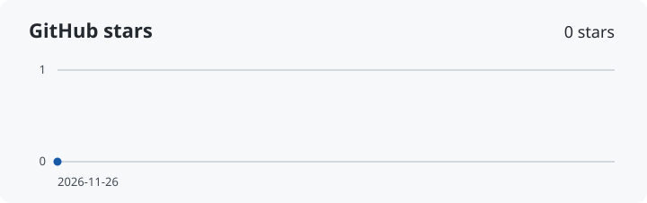

<h1 align="center">
  awesome-loop-transformer
  
</h1>

  
  

A **Loop Transformer** applies the same block of layers repeatedly to an evolving hidden state. Before predicting the next token, a language model can take several passes through that block while keeping the input prefix fixed. [Universal Transformers](https://arxiv.org/abs/1807.03819) · [Huginn](https://arxiv.org/abs/2502.05171)

[Five papers to start with](#selected-readings) · [Browse by loop mechanism](#browse-by-loop-mechanism) · [Models and weights](#models-and-weights) · [Origins](#historical-development) · [Papers by topic](#looped-transformer-papers) · [Other language model loops](#other-loops-in-language-models) · [Technical reports and tools](#technical-reports-and-tools) · [Contribute](#contributing)

<!-- catalog:overview -->

The collection includes **85 papers on looped Transformers**, **31 on related language model loops**, and **52 model entries with downloadable weights**.

<!-- /catalog:overview -->

## Selected readings

1. **How does a layer loop?** Figure 2 of Dehghani et al. (2018) shows attention mixing information across positions and the same block updating each position across depth. [Universal Transformers, Fig. 2](https://arxiv.org/html/1807.03819v3#S2.F2)
2. **What can the shared update learn?** Yang et al. (2023) compare looped and untied Transformers on in-context linear regression. Follow how prediction error changes with each pass. [Looped Transformers are Better at Learning Learning Algorithms](https://arxiv.org/abs/2311.12424) · [Experiments](https://github.com/Leiay/looped_transformer)
3. **What does another pass buy at inference?** Geiping et al. (2025) vary the recurrent depth of one Huginn checkpoint. Its `num_steps` setting lets you compare depths with the prompt and decoding settings held fixed. [Scaling up Test-Time Compute with Latent Reasoning](https://arxiv.org/abs/2502.05171) · [NeurIPS proceedings](https://proceedings.neurips.cc/paper_files/paper/2025/hash/3b01972cf31e6fa0fe29e4b8b5c2a0a1-Abstract-Conference.html) · [Checkpoint](https://huggingface.co/tomg-group-umd/huginn-0125)
4. **Can we read the intermediate states?** Lu et al. (2025) compare two probes at the same depth in Huginn. The probes differ in which intermediate arithmetic results they recover. [Latent Chain-of-Thought?](https://arxiv.org/abs/2507.02199) · [Probe code](https://github.com/wenquanlu/huginn-latent-cot)
5. **What does sharing save during training?** Schwethelm et al. (2026) report a four-pass 410M model matching the validation loss of a 580M untied model at roughly the training cost of a 1B untied model. [How Much Is One Recurrence Worth?](https://arxiv.org/abs/2604.21106) · [Scaling experiments](https://github.com/kschwethelm/looped-lm-scaling)

Read Huginn’s validation curves at different recurrent depths

**Reading a depth sweep.** Each curve evaluates Huginn at one recurrent depth. Compare curves at the same training checkpoint to measure the effect of spending more inference compute. Follow one curve over training to see how the model learns to use that depth. [Geiping et al., Figure 6, right panel](https://arxiv.org/html/2502.05171v2#S4.F6)

## Browse by loop mechanism

| Research question | Examples and reading paths |
| --- | --- |
| **Where does the state go on the next pass?** | In the [decoder diagrams](#five-decoder-architectures), Ouro repeats the full stack and Dory repeats its middle layers before emitting the next token. [HRM](#hrm) updates a fast state several times per slow-state update. [Block-Recurrent Transformers](#paper-block-recurrent-transformers) carry state from one block of input tokens to the next. |
| **Who decides how many passes to run?** | [Inkling 2 Mini](#five-decoder-architectures) uses three passes in its released model. [Huginn](#huginn) lets the caller set the depth. [Mixture-of-Recursions](#paper-mixture-of-recursions) routes tokens to different depths. [TaH2](#model-tah) learns which tokens benefit from another pass. [Ouro’s learned exit gate](#paper-adaptive-depth) uses intermediate states to choose an exit. [FPRM](#fprm) stops at a residual tolerance or a solver limit. |
| **How is the loop introduced?** | [Huginn](#huginn) is pretrained with a recurrent core. [LoopUS](#loopus) converts a pretrained backbone and trains it to reuse a block. In [Training-Free Looped Transformers](#paper-training-free-looped-transformers), an inference wrapper applies smaller residual updates on repeated passes through a frozen checkpoint. |

[Latent Feedback](#model-latent-feedback) carries a hidden state into the next token. [Trading Depth for Time](#paper-trading-depth) tests what happens when an extra latent step fits between two tokens at a fixed decoding budget. Elsewhere in the catalog, an iteration can produce a [revised draft](#editing-and-denoising-text), [feedback or a tool observation](#feedback-retrieval-and-search), or [updated model weights](#training-across-rounds).

## Models and weights

### Five decoder architectures

**Figure source** · Sebastian Raschka, 24 November 2026. [Original post on X](https://x.com/rasbt/status/2125249956495953973) · [Full-resolution figure](https://pbs.twimg.com/media/HX5njjzXIAAYbxm?format=jpg&name=orig) · [LLM Architecture Gallery](https://sebastianraschka.com/llm-architecture-gallery/looped-depth-sharing/)

Follow the return arrow to see which layers process the same token again.

<!-- catalog:comparison -->

Ouro and Nanbeige repeat the full decoder. GLM-5.4, Dory and Inkling repeat only the middle blocks. The model names link to Sebastian Raschka’s diagrams. The pass schedules link to the publishers’ configurations or release notes. Weight availability was checked on 26 November 2026.

| Model | Pass schedule | Distinct blocks | Block applications per token | Weights |
| --- | --- | ---: | ---: | --- |
| [Ouro-Thinking 2.6B](https://sebastianraschka.com/llm-architecture-gallery/models/ouro-thinking-2-6b/) | [48 × 4](https://huggingface.co/ByteDance/Ouro-2.6B-Thinking/blob/main/config.json) | 48 | 192 | [Thinking checkpoint](https://huggingface.co/ByteDance/Ouro-2.6B-Thinking/tree/main) |
| [Nanbeige 4.2 3B](https://sebastianraschka.com/llm-architecture-gallery/models/nanbeige-4-2-3b/) | [22 × 2](https://huggingface.co/Nanbeige/Nanbeige4.2-3B/blob/main/config.json) | 22 | 44 | [Post-trained checkpoint](https://huggingface.co/Nanbeige/Nanbeige4.2-3B/tree/main) |
| [GLM-5.4](https://sebastianraschka.com/llm-architecture-gallery/models/glm-5-4/) | [26 + 28 × 2 + 24](https://z.ai/blog/glm-5.4?lang=en) | 78 | 106 | Release planned |
| [Dory1.0 4B](https://sebastianraschka.com/llm-architecture-gallery/models/dory1-0-4b/) | [8 + 20 × 2 + 8](https://huggingface.co/nvidia/NVIDIA-Nemotron-Labs-Dory1.0-4B-BF16/blob/main/config.json) | 36 | 56 | [BF16 checkpoint](https://huggingface.co/nvidia/NVIDIA-Nemotron-Labs-Dory1.0-4B-BF16/tree/main) |
| [Inkling 2 Mini](https://sebastianraschka.com/llm-architecture-gallery/models/inkling-2-mini/) | [6 + 12 × 3 + 6](https://huggingface.co/thinkingmachines/Inkling-2-Mini/blob/main/config.json) | 24 | 48 | [Fixed three-pass checkpoint](https://huggingface.co/thinkingmachines/Inkling-2-Mini/tree/main) |

Trace the five pass schedules block by block

GLM-5.4 runs layers 1–26 once, 27–54 twice and 55–78 once, for 106 block applications across 78 distinct blocks. Counts exclude embedding and output layers. Dory’s configuration counts attention and feed-forward sublayers separately, so its 40 recurrent sublayers correspond to 20 Transformer blocks. [Gallery comparison](https://sebastianraschka.com/llm-architecture-gallery/looped-depth-sharing/)

<!-- /catalog:comparison -->

<!-- catalog:models -->

Checkpoint links open the weight files or the publisher’s release directory. Each entry was checked for public weight files on 2026-11-26. The license column reports the terms the publisher gives for the weights. “Unspecified” means no weight license was identified. For adapters, the entry names the required base model.

- [Shared-depth language models](#shared-depth-language-models)
- [Puzzle reasoning](#puzzle-reasoning)
- [Vision, action and scientific sequences](#vision-action-and-scientific-sequences)
- [Tabular classification](#tabular-classification)
- [Sequence recurrence and iterative decoding](#sequence-recurrence-and-iterative-decoding)
- [Release variants](#release-variants)
- [Research releases](#research-releases)

### Shared-depth language models

| Model family | Recurrent mechanism | Released checkpoints | Reference | Weight license |
| --- | --- | --- | --- | --- |
| ALBERT | A fixed-depth encoder with cross-layer parameter sharing. The base-v2 release is a compact reference for studying weight tying in masked language modeling. | [Base v2](https://huggingface.co/albert/albert-base-v2/tree/main) | [ALBERT](https://arxiv.org/abs/1909.11942) | Apache-2.0 |
| ARLoop | Uses attention over earlier layer states to decide what each layer reads. The authors also release a 0.6B looped baseline with standard pre-normalization for a same-size residual-design comparison. | [0.6B](https://huggingface.co/osunlp/ARLoop-0.6B/tree/main) · [0.6B baseline](https://huggingface.co/osunlp/ARLoop-baseline-0.6B/tree/main) · [1.2B](https://huggingface.co/osunlp/ARLoop-1.2B/tree/main) | [ARLoop report](https://arxiv.org/abs/2611.05234) | Apache-2.0 |
| [Attractor LM](#attractor-lm) | A language backbone proposes an output state. A second, shared module refines it toward equilibrium, conditioned on that initial proposal. | [770M](https://huggingface.co/jacobfa1/attractor-770m/tree/main) | [Paper](https://arxiv.org/abs/2605.12466) | MIT |
| Concertina-2.27B | Each pair of adjacent layers in Qwen3-4B becomes one block run twice, with token-gated low-rank corrections. The distilled student runs on its own with the custom Transformers code included in the release. | [2.27B student](https://huggingface.co/myboker/Concertina-2.27B/tree/main) | [Paper](https://arxiv.org/abs/2611.18113) · [Loading example](https://huggingface.co/myboker/Concertina-2.27B) | Apache-2.0 |
| DEQ-Transformer | A fixed-point solver repeatedly applies a shared self-attention transformation until it reaches an equilibrium or its iteration limit. The authors released the full word-level language model trained on WikiText-103. | [pretrained_wt103_deqtrans_v3.pkl](https://drive.google.com/file/d/1lZx_sHt0-1gJVgXx90LDRizq3k-ZI0SW/view) | [Deep Equilibrium Models](https://arxiv.org/abs/1909.01377) · [Release and evaluation instructions](https://github.com/locuslab/deq/tree/master/DEQ-Sequence#pre-trained-models) | Unspecified |
| [Dory 1.0](#five-decoder-architectures) | The BF16 checkpoint runs eight prefix blocks, 20 shared blocks twice (`n_recurrent_loops=2`), then eight suffix blocks. The default `recurrent_kv_cache_mode=per_loop` keeps a separate KV cache for each pass. Set it to `last_loop` to keep one cache per recurrent attention layer. | [4B BF16](https://huggingface.co/nvidia/NVIDIA-Nemotron-Labs-Dory1.0-4B-BF16/tree/main) · [4B NVFP4](https://huggingface.co/nvidia/NVIDIA-Nemotron-Labs-Dory1.0-4B-NVFP4/tree/main) · [MXFP8](https://huggingface.co/nvidia/NVIDIA-Nemotron-Labs-Dory1.0-4B-MXFP8/tree/main) · [GGUF](https://huggingface.co/nvidia/NVIDIA-Nemotron-Labs-Dory1.0-4B-GGUF/tree/main) | [Dory report](https://arxiv.org/abs/2611.03998) · [BF16 config](https://huggingface.co/nvidia/NVIDIA-Nemotron-Labs-Dory1.0-4B-BF16/blob/main/config.json) · [KV cache settings](https://huggingface.co/nvidia/NVIDIA-Nemotron-Labs-Dory1.0-4B-BF16#reducing-the-kv-cache-memory-overhead) | OpenMDW-1.1 |
| Gated Recurrent Transformer (GRT) | A gate blends the previous state with a shared core update between a fixed prelude and coda. Releases include compute-matched and parameter-matched training configurations. | [large-isoflop](https://huggingface.co/Amr-Hegazy/grt-large-isoflop/tree/main) · [large-isoparam](https://huggingface.co/Amr-Hegazy/grt-large-isoparam/tree/main) · [medium-isoflop](https://huggingface.co/Amr-Hegazy/grt-medium-isoflop/tree/main) · [medium-isoparam](https://huggingface.co/Amr-Hegazy/grt-medium-isoparam/tree/main) | [Paper](https://arxiv.org/abs/2608.15062) | CC-BY-4.0 |
| HRM-Text | Applies fast and slow recurrent modules to text generation. This release uses a task-completion objective on instruction–response pairs. | [1B original release](https://huggingface.co/sapientinc/HRM-Text-1B/tree/main) | [HRM-Text report](https://arxiv.org/abs/2605.20613) | Apache-2.0 |
| [Huginn](#huginn) | A 3.5B language model with a recurrent core between distinct input and output stacks. The same checkpoint supports different recurrence counts at inference. | [Huginn-0125](https://huggingface.co/tomg-group-umd/huginn-0125/tree/main) | [Recurrent depth report](https://arxiv.org/abs/2502.05171) | Apache-2.0 |
| [Inkling 2 Mini](#five-decoder-architectures) | Runs six prefix blocks once, twelve shared middle blocks three times and six suffix blocks once. A separate research checkpoint supports experiments that vary the pass count. | [Inkling 2 Mini](https://huggingface.co/thinkingmachines/Inkling-2-Mini/tree/main) · [Variable-loop research checkpoint](https://huggingface.co/thinkingmachines/TML-d24-varloop-research/tree/main) | [Thinking Machines Lab release](https://thinkingmachines.ai/news/inkling-2-mini/) | Apache-2.0 |
| LatentLoop | The two middle passes share mixture-of-experts weights and have separate attention parameters. The first pass processes a compressed sequence, then its update feeds the full-length second pass. Each folder holds a separately trained model for the authors’ PyTorch loader. | [1.3B](https://huggingface.co/yhx12/LatentLoop/tree/main/1.3B-40B) · [3B](https://huggingface.co/yhx12/LatentLoop/tree/main/3B-70B) · [7B](https://huggingface.co/yhx12/LatentLoop/tree/main/7B-140B) | [Paper](https://arxiv.org/abs/2610.19975) · [Loading example](https://huggingface.co/yhx12/LatentLoop#load-and-generate) | Apache-2.0 |
| LatentMT | Each translation direction has its own LoRA adapter. Load it on [ByteDance/Ouro-2.6B-Thinking](https://huggingface.co/ByteDance/Ouro-2.6B-Thinking) and run four recurrent passes. | [English → Simplified Chinese adapter](https://huggingface.co/wrchen1/LatentMT-2.6B-eng-latn-zho-hans/tree/main) · [All 32 translation directions](https://huggingface.co/collections/wrchen1/latentmt-6a8b943b0e9b48dcb43f3e9c) | [Paper](https://arxiv.org/abs/2607.18618) · [Model card and loading example](https://huggingface.co/wrchen1/LatentMT-2.6B-eng-latn-zho-hans) | Apache-2.0 (adapter) |
| LEV | Scores the answer options after each pass through a looped backbone. Each release contains an adapter and decision head to use with its base model. | [1.4B adapter](https://huggingface.co/songdj/Lev-1.4B/tree/main) · [2.6B adapter](https://huggingface.co/songdj/Lev-2.6B/tree/main) · [3B adapter](https://huggingface.co/songdj/Lev-3B/tree/main) | [Paper](https://arxiv.org/abs/2610.20951) | Apache-2.0 |
| LOTUS | Shared passes refine padded latent reasoning positions in parallel. `from_pretrained` loads the weights. The authors’ GSM8K script runs the loop with `--n_looped_iters 6`. Use `--c_thought 25` for the standard and CODI checkpoints or `--c_thought 50` for the natural-language variant to set the number of tokens per latent block. | [GSM-LLaMA 3B](https://huggingface.co/yingfanbot/gsm-lotus-llama3b/tree/main) · [CODI variant](https://huggingface.co/yingfanbot/gsm-lotus-llama3b-codi/tree/main) · [Natural-language variant](https://huggingface.co/yingfanbot/gsm-lotus-llama3b-nl/tree/main) | [Paper](https://arxiv.org/abs/2606.31779) · [Evaluation script](https://github.com/yingfan-bot/lotus/blob/main/scripts/eval.py) · [GSM8K command](https://huggingface.co/yingfanbot/gsm-lotus-llama3b#reproduce-the-number-above) | MIT |
| LoopCoder-v2 | A 7B instruction-tuned coding model. The downloadable variant runs its 14 shared layers twice. | [7B two-loop checkpoint](https://huggingface.co/Multilingual-Multimodal-NLP/LoopCoder-V2/tree/main) | [Loop-count study](https://arxiv.org/abs/2606.18023) | Apache-2.0 |
| LoopFormer | Three models pair different block counts and iteration counts for the same nominal depth of 24. Shortcut modulation allows shorter inference trajectories. | [1 × 24](https://huggingface.co/armenjeddi/LoopFormer-1block-24iterations/tree/main) · [2 × 12](https://huggingface.co/armenjeddi/LoopFormer-2block-12iterations/tree/main) · [3 × 8](https://huggingface.co/armenjeddi/LoopFormer-3block-8iterations/tree/main) | [LoopFormer paper](https://arxiv.org/abs/2602.11451) | Unspecified |
| LoopRes | Looped layers attend to a window of their own outputs from earlier passes when adapting a pretrained language model. | [Qwen3-1.7B](https://huggingface.co/oahzxl/LoopRes-Qwen3-1.7B/tree/main) | [Paper](https://arxiv.org/abs/2611.31094) | MIT |
| [LoopUS](#loopus) | Converts Qwen3 into an encoder, shared reasoning block, and decoder. A confidence head can terminate the recurrent stage early. | [Qwen3-1.7B retrofit](https://huggingface.co/Thrillcrazyer/Qwen3_1.7B_LoopUS/tree/main) | [LoopUS paper](https://arxiv.org/abs/2605.11011) | Apache-2.0 |
| Looped GPT-BERT | The BabyLM Strict-small release traverses four shared layers twelve times. It combines causal and masked next-token training. | [4 layers × 12 passes](https://huggingface.co/Survivor613/BabyLM2026-Strict-Small-looped_GPT-BERT/tree/main) | [Paper](https://arxiv.org/abs/2609.09691) | Unspecified |
| Metis-1.6 | Praxis and Logos each run a hybrid Mamba-2 and attention mixture-of-experts stack twice per token. | [Logos](https://huggingface.co/Lernex/Metis-1.6-Logos/tree/main) · [Praxis-Base](https://huggingface.co/Lernex/Metis-1.6-Praxis-Base/tree/main) · [Logos-Base](https://huggingface.co/Lernex/Metis-1.6-Logos-Base/tree/main) · [Praxis](https://huggingface.co/Lernex/Metis-1.6-Praxis/tree/main) · [Precision variants](#metis-16) | [Paper](https://arxiv.org/abs/2610.37903) | Apache-2.0 |
| Mixture-of-Recursions (MoR) | A router selects which tokens continue through the shared block. Compare expert-choice and token-choice routing at a maximum depth of three against the fixed-depth recursive model and the vanilla Transformer from the same experiment series. | [Expert-choice ×3](https://drive.google.com/drive/folders/1HhTWzo9lBrSHcljPBOUch3C0bz5O5s39) · [Token-choice ×3](https://drive.google.com/drive/folders/1F08AjAigrmjzpb981AAvJakjQt-UTCCV) · [Fixed ×3](https://drive.google.com/drive/folders/1JJuWZ1BWdXSEsSoU0AEr9GV-p3XMvuIo) · [Vanilla](https://drive.google.com/drive/folders/1t1TmKA05PY1bGQHrbkxz8yPiU1EiExaB) · [All nine checkpoints](https://drive.google.com/drive/folders/1pYKJOu2aBGC-jgoWbfP6T_vqEYtUVxa4) | [Paper](https://arxiv.org/abs/2507.10524) · [Checkpoint guide](https://github.com/raymin0223/mixture_of_recursions#-pretrained-checkpoints) | Unspecified |
| [Nanbeige4.2](#five-decoder-architectures) | The 3B model runs all 22 shared layers twice. The report covers the base model and post-training for tool use and coding. The reported 3B count excludes embeddings. | [3B base](https://huggingface.co/Nanbeige/Nanbeige4.2-3B-Base/tree/main) · [3B post-trained](https://huggingface.co/Nanbeige/Nanbeige4.2-3B/tree/main) | [Nanbeige4.2 technical report](https://arxiv.org/abs/2607.22083) | Apache-2.0 |
| OrbitLM-1.8B-Thinking | The released bilingual model runs the same 24 Ouro-style layers four times per token. It was pretrained from scratch on English and Russian text, then fine-tuned with supervised examples and GRPO. | [1.8B Thinking](https://huggingface.co/ai-forever/OrbitLM-1.8B-Thinking/tree/main) | [Training study](https://arxiv.org/abs/2610.00673) · [Released model and training recipe](https://huggingface.co/ai-forever/OrbitLM-1.8B-Thinking) | Apache-2.0 |
| [Ouro](#ouro) | The 2.6B Thinking config runs 48 shared layers four times. The released implementation computes gate scores at each pass. | [1.4B base](https://huggingface.co/ByteDance/Ouro-1.4B/tree/main) · [1.4B Thinking](https://huggingface.co/ByteDance/Ouro-1.4B-Thinking/tree/main) · [2.6B base](https://huggingface.co/ByteDance/Ouro-2.6B/tree/main) · [2.6B Thinking](https://huggingface.co/ByteDance/Ouro-2.6B-Thinking/tree/main) | [Ouro report](https://arxiv.org/abs/2510.25741) | Apache-2.0 |
| Parcae | The recurrent block mixes the encoded input with the current state under a constraint that limits amplification across passes. The four model sizes support depth sweeps at a fixed parameter count. Load them with `parcae_lm.from_pretrained`. | [140M](https://huggingface.co/SandyResearch/parcae-140m/tree/main) · [370M](https://huggingface.co/SandyResearch/parcae-370m/tree/main) · [770M](https://huggingface.co/SandyResearch/parcae-770m/tree/main) · [1.3B](https://huggingface.co/SandyResearch/parcae-1.3b/tree/main) | [Paper](https://arxiv.org/abs/2604.12946) · [Loader](https://github.com/sandyresearch/parcae#models) | Unspecified |
| Retrofitted TinyLlama | Two conversions of the same pretrained backbone with different target training recurrence counts. These are separately trained models. | [4 recurrences](https://huggingface.co/smcleish/Recurrent-TinyLlama-3T-train-recurrence-4/tree/main) · [32 recurrences](https://huggingface.co/smcleish/Recurrent-TinyLlama-3T-train-recurrence-32/tree/main) · [All backbones and controls](#retrofitted-language-models) | [Retrofitting study](https://arxiv.org/abs/2511.07384) | Apache-2.0 |
| Think-at-Hard / TaH2 | A learned decision module selects tokens for another pass. The TaH2 two-pass release includes the 1.7B backbone, an input updater and the decision module. Compare it with the single-pass TaH2 control using the authors’ inference code. | [TaH-plus 1.7B](https://huggingface.co/nics-efc/TaH-plus-1.7B/tree/main) · [TaH2 at most two passes](https://huggingface.co/nics-efc/TaH2-1.7B-max2/tree/main) · [TaH2 single-pass control](https://huggingface.co/nics-efc/TaH2-1.7B-Standard/tree/main) | [TaH](https://arxiv.org/abs/2511.08577) · [TaH2](https://arxiv.org/abs/2609.35748) · [Inference code](https://github.com/thu-nics/TaH) | Apache-2.0 |
| Towards Looped Models Done Right | Part I compares loop placement, input injection and recurrent state design. Part II varies the training depth distribution and how the input is reinjected. The authors’ xLLM loader reads all 49 checkpoints, including baselines and distilled students. | [Part I dense Huginn](https://huggingface.co/IFM/LoopedLM-P1-dense-huginn-336b/tree/main) · [Part II learned depth prior](https://huggingface.co/IFM/LoopedLM-P2-huginn-m-learned-entropy0p01/tree/main) · [All 49 checkpoints](https://huggingface.co/collections/IFM/towards-looped-models-done-right) | [Part I](https://arxiv.org/abs/2610.23036) · [Part II](https://arxiv.org/abs/2610.06833) · [xLLM loader and manifest](https://github.com/ifm-ai/xllm-loop#checkpoints) | Apache-2.0 |

#### Huginn

Read the blue, green and red blocks from left to right. The prelude encodes the tokens once. Each green pass receives the current latent state and the encoded input. The coda reads the final state to predict the next token. Changing the pass count changes the depth of the same checkpoint.

Architecture figure and sources for Huginn

[Original figure 2](https://arxiv.org/html/2502.05171v2#S2.F2) · [Paper](https://arxiv.org/abs/2502.05171) · [Weight files](https://huggingface.co/tomg-group-umd/huginn-0125/tree/main)

#### Ouro

Follow one position up the stack. Each pass updates its hidden state with the same layers. In training the authors attach a prediction loss at each depth. The paper describes early stopping based on accumulated exit probability. The released Hugging Face implementation runs the configured passes before choosing or weighting their outputs. [Publisher implementation](https://huggingface.co/ByteDance/Ouro-2.6B-Thinking/blob/main/modeling_ouro.py)

Architecture figure and sources for Ouro

[Original figure 3](https://arxiv.org/html/2510.25741v5#S3.F3) · [Paper](https://arxiv.org/abs/2510.25741) · [Weight files](https://huggingface.co/ByteDance/Ouro-1.4B/tree/main)

#### LoopUS

Panel (a) divides the pretrained layers into an encoder, a reasoning block and a decoder. The reasoning block is reused, with a gate between iterations. Panel (b) shows the supervision used to train the confidence signal that can end refinement.

Architecture figure and sources for LoopUS

[Original figure 2](https://arxiv.org/html/2605.11011v1#S3.F2) · [Paper](https://arxiv.org/abs/2605.11011) · [Weight files](https://huggingface.co/Thrillcrazyer/Qwen3_1.7B_LoopUS/tree/main)

#### Attractor LM

The backbone makes an initial proposal. On every solver step the attractor module reads both that original proposal and the current estimate. The output head reads the final estimate when the solver converges or reaches its step limit.

Architecture figure and sources for Attractor LM

[Original figure 3](https://arxiv.org/html/2605.12466v1#S3.F3) · [Paper](https://arxiv.org/abs/2605.12466) · [Weight files](https://huggingface.co/jacobfa1/attractor-770m/tree/main)

### Puzzle reasoning

| Model family | Recurrent mechanism | Released checkpoints | Reference | Weight license |
| --- | --- | --- | --- | --- |
| Equilibrium Reasoners (EqR) | Iterates a recurrent solver toward a puzzle solution. The implementation supports attention and MLP variants. | [Maze and Sudoku](https://huggingface.co/locuslab/EqR-model/tree/main) | [Paper](https://arxiv.org/abs/2605.21488) | Unspecified |
| [FPRM](#fprm) | A shared Transformer update refines a puzzle state. The model uses convergence as its halting signal. | [ARC, maze and Sudoku checkpoints](https://huggingface.co/fixed-point-reasoners/fprm/tree/main) | [Paper](https://arxiv.org/abs/2606.18206) | MIT |
| [HRM](#hrm) | Two recurrent attention modules run at different rates. Each task has its own checkpoint; the files are named `checkpoint`. | [ARC-AGI-2](https://huggingface.co/sapientinc/HRM-checkpoint-ARC-2/tree/main) · [Sudoku Extreme](https://huggingface.co/sapientinc/HRM-checkpoint-sudoku-extreme/tree/main) · [Maze-Hard](https://huggingface.co/sapientinc/HRM-checkpoint-maze-30x30-hard/tree/main) | [HRM paper](https://arxiv.org/abs/2506.21734) | Unspecified |
| Input-Conditioned Search (ICS) | An inference procedure for recurrent puzzle solvers. Changing the input condition gives the same state a different update trajectory. The release includes task-specific solver weights. | [Solver checkpoints](https://huggingface.co/hcshi/ICS/tree/main) | [Paper](https://arxiv.org/abs/2610.18547) | MIT |
| [Tiny Recursive Model (TRM)](#tiny-recursive-model) | A small shared network alternates latent refinement and answer updates. ARC Prize independently trained and released the ARC evaluation checkpoints using the authors’ recipe. | [ARC Prize verification weights](https://huggingface.co/arcprize/trm_arc_prize_verification/tree/main) | [Paper](https://arxiv.org/abs/2510.04871) | MIT |

#### HRM

Follow the low-level state through several updates while the high-level state is held fixed. The high-level module then reads the revised low-level state and updates its own state. Each module has its own weights, reused on its own schedule.

Architecture figure and sources for HRM

[Original figure 4](https://arxiv.org/html/2506.21734v3#S2.F4) · [Paper](https://arxiv.org/abs/2506.21734) · [Weight files](https://huggingface.co/sapientinc/HRM-checkpoint-ARC-2/tree/main)

#### Tiny Recursive Model

Read the inner path first. A small network updates a latent state from the question, the current answer and the preceding latent. The answer update then reads the revised latent. The linked ARC checkpoints were trained by ARC Prize for independent verification.

Architecture figure and sources for Tiny Recursive Model

[Original figure 1](https://arxiv.org/html/2510.04871v1#S1.F1) · [Paper](https://arxiv.org/abs/2510.04871) · [Weight files](https://huggingface.co/arcprize/trm_arc_prize_verification/tree/main)

#### FPRM

The recurrent Transformer repeatedly updates the puzzle representation. Pre-normalization and residual scaling control propagation through repeated steps. The change between successive states supplies a signal for deciding when to stop.

Architecture figure and sources for FPRM

[Original figure 3](https://arxiv.org/html/2606.18206v1#S1.F3.fig2) · [Paper](https://arxiv.org/abs/2606.18206) · [Weight files](https://huggingface.co/fixed-point-reasoners/fprm/tree/main)

### Vision, action and scientific sequences

| Model family | Recurrent mechanism | Released checkpoints | Reference | Weight license |
| --- | --- | --- | --- | --- |
| AdaLoop | Uses the question to condition further passes through a frozen vision encoder. The release includes base-model files and adaptation weights. | [Vision-language adapters and bases](https://huggingface.co/Lyy0725/AdaLoop/tree/main) | [Paper](https://arxiv.org/abs/2610.21323) | Base-model terms |
| Déjà View | Repeats a decoder block on multi-view image features to refine a 3D reconstruction. | [Multi-view reconstruction](https://huggingface.co/nvidia/dvlt/tree/main) | [Paper](https://arxiv.org/abs/2605.30215) | NVIDIA OneWay Noncommercial |
| [Dooop](#dooop) | Distills a diffusion Transformer into a student whose shared block produces a supervised output at each depth. The hub contains the looped diffusion components. | [SD3 Medium and Turbo](https://huggingface.co/ShimaRinC/Distill-to-Loop/tree/main) | [Paper](https://arxiv.org/abs/2611.31977) | Stability AI Non-Commercial Research Community |
| Jina-OCR-v1 | A shared draft block predicts three future positions for speculative decoding. The OCR decoder verifies the draft. | [OCR model and FastMTP head](https://huggingface.co/jinaai/jina-ocr-v1/tree/main) | [Paper](https://arxiv.org/abs/2609.03181) | CC-BY-NC-4.0 |
| Looped-DiT | Reapplies Transformer blocks within a diffusion denoising step. Loop count and sampling steps control different parts of generation. | [B/16](https://huggingface.co/sensenova/Looped-DiT-B16/tree/main) · [B/32](https://huggingface.co/sensenova/Looped-DiT-B32/tree/main) | [Paper](https://arxiv.org/abs/2609.40305) | MIT |
| [LoopVL](#loopvl) | Refines a joint vision–language state through module-level and model-level loops. The authors expose the two recurrence counts for inference. | [LoopVL-1B](https://huggingface.co/TierFlow/LoopVL/tree/main) | [LoopVL paper](https://arxiv.org/abs/2609.38426) | Unspecified |
| [LoopedWAM](#loopedwam) | The video and action experts each reuse a core. The action expert can take a different number of passes while reading cached video features. | [Task-specific policies and elastic variants](https://huggingface.co/anhdao69/LoopedWAM/tree/main) | [Paper](https://arxiv.org/abs/2611.25595) | Apache-2.0 |
| RD-VLA | Repeats a weight-tied Transformer in the action head. Each file tree includes the action head and its associated model components for one LIBERO evaluation suite. | [Spatial, 40k steps](https://huggingface.co/hqfang/12_24-24_24_Spatial_40k/tree/main) · [Long, 75k steps](https://huggingface.co/hqfang/12_24-24_24_Long_75k/tree/main) | [RD-VLA paper](https://arxiv.org/abs/2602.07845) | Apache-2.0 |
| recAMPLIFY | A masked protein language model applies a weight-tied Transformer core to residue representations for a configurable number of cycles. | [Recurrent, gated and baseline variants](https://huggingface.co/chandar-lab/recamplify/tree/main) | [Paper](https://arxiv.org/abs/2610.26747) | MIT |
| [Solv3R](#solv3r) | One shared solver updates the state of each camera view using features from across the scene. It can continue refining the same images or incorporate new views before predicting depth and camera poses. | [117M reconstruction model](https://huggingface.co/jgkwak/solv3r/tree/main) | [Paper](https://arxiv.org/abs/2611.02857) · [Inference code](https://github.com/ubc-vision/solv3r) | [NVIDIA License (non-commercial)](https://huggingface.co/jgkwak/solv3r/blob/main/LICENSE) |

#### LoopVL

The vision encoder and projector supply visual positions alongside instruction tokens. In the default schedule the low-level module runs three times, then the high-level module runs once. That entire cycle runs twice. The two modules own separate weights.

Architecture figure and sources for LoopVL

[Original figure 2](https://arxiv.org/html/2609.38426v1#S2.F2) · [Paper](https://arxiv.org/abs/2609.38426) · [Weight files](https://huggingface.co/TierFlow/LoopVL/tree/main)

#### LoopedWAM

The video expert reuses its core to encode the frame and caches its keys and values. At each action sampling step the action expert reuses its own core and attends to those cached features. The two experts can use different loop counts.

Architecture figure and sources for LoopedWAM

[Original figure 2](https://arxiv.org/html/2611.25595v2#S3.F2) · [Paper](https://arxiv.org/abs/2611.25595) · [Weight files](https://huggingface.co/anhdao69/LoopedWAM/tree/main)

#### Dooop

Panel (c) unrolls the student at a single diffusion time. Each round applies the same Transformer blocks to the previous hidden state and produces an intermediate output. These depth updates occur inside a denoising step. The teacher supplies the training targets.

Architecture figure and sources for Dooop

[Original figure 2](https://arxiv.org/html/2611.31977v1#S3.F2) · [Paper](https://arxiv.org/abs/2611.31977) · [Weight files](https://huggingface.co/ShimaRinC/Distill-to-Loop/tree/main)

#### Solv3R

Follow one view across the solver calls. Each call applies the same block, attending first within each image and then across views. When a new image arrives, the block can refine its initial state alongside the current states of earlier views. Decoding those states gives updated camera poses and depth maps.

Architecture figure and sources for Solv3R

Figure 4 by Jeong-gi Kwak et al. (2026), licensed under [CC BY 4.0](https://creativecommons.org/licenses/by/4.0/). [Original figure 4](https://arxiv.org/html/2611.02857v2#S2.F4) · [Project page](https://ubc-vision.github.io/solv3r/) · [117M checkpoint](https://huggingface.co/jgkwak/solv3r/tree/main)

### Tabular classification

| Model family | Recurrent mechanism | Released checkpoints | Reference | Weight license |
| --- | --- | --- | --- | --- |
| LoopICL | A shared Transformer block refines cell and row representations for in-context classification. Compare a fixed pass budget with a learned early-exit gate using the two full classifier checkpoints (about 6.6 MB each). | [Standard classifier](https://github.com/amirbalef/loopicl/blob/main/src/loopicl/weights/loopicl-cls-stage2-step-30000.ckpt) · [Early-exit classifier](https://github.com/amirbalef/loopicl/blob/main/src/loopicl/weights/loopicl-cls-ee-step-4000.ckpt) | [Paper](https://arxiv.org/abs/2609.36108) · [Inference example](https://github.com/amirbalef/loopicl/blob/main/notebooks/classification_example.ipynb) | Unspecified |

### Sequence recurrence and iterative decoding

| Model family | Recurrent mechanism | Released checkpoints | Reference | Weight license |
| --- | --- | --- | --- | --- |
| ALoDLM | Within each denoising step, unresolved positions carry their latent states through more shared passes. Committed tokens become context. Both releases include backbone weights and the learned exit gate (`exit_gate.pt`) for the authors’ decoder. | [1.7B](https://huggingface.co/amazon/ALoDLM-1.7B/tree/main) · [8B](https://huggingface.co/amazon/ALoDLM-8B/tree/main) | [Paper](https://arxiv.org/abs/2610.04198) · [Decoder](https://github.com/amazon-science/ALoDLM) | CC-BY-NC-4.0 |
| Latent Feedback | Each token passes its top-layer state to the next token’s input. The linked 134M runs compare feedback with a plain Transformer at the same unique-data and training-compute budgets. Use the LoRM code to load each `checkpoint.pt`. | [134M feedback](https://huggingface.co/IFM/latent-feedback-checkpoints/tree/main/feedback-134m-u100-f1) · [134M matched control](https://huggingface.co/IFM/latent-feedback-checkpoints/tree/main/transformer-134m-u100-f1) | [Paper](https://arxiv.org/abs/2611.20404) · [LoRM experiments](https://github.com/ifm-ai/LoRM/tree/main/works/latent_feedback) | Apache-2.0 |
| LLaDA | Repeatedly fills masked response positions conditioned on the prompt. | [8B Instruct](https://huggingface.co/GSAI-ML/LLaDA-8B-Instruct/tree/main) | [LLaDA](https://arxiv.org/abs/2502.09992) | MIT |
| Looped UDLM | Repeats early Transformer layers during a denoising step of a uniform diffusion language model. The release includes looped and baseline training runs. | [OpenWebText checkpoints](https://huggingface.co/saitejautpala/looped_udlm/tree/main) | [Paper](https://arxiv.org/abs/2610.30066) | Apache-2.0 |
| Mamba | Updates a selective state-space representation as the sequence advances. | [130M base, original format](https://huggingface.co/state-spaces/mamba-130m/tree/main) | [Mamba](https://arxiv.org/abs/2312.00752) | Apache-2.0 |
| MDLM | Repeatedly denoises a partially masked sequence. | [OpenWebText checkpoint](https://huggingface.co/kuleshov-group/mdlm-owt/tree/main) | [MDLM](https://arxiv.org/abs/2406.07524) | Apache-2.0 |
| RWKV-4 | Updates the recurrent state once per input token. | [169M Pile](https://huggingface.co/RWKV/rwkv-4-169m-pile/tree/main) | [RWKV](https://arxiv.org/abs/2305.13048) | Unspecified |
| URCHIN | A spiking language model recirculates the current token’s activity through a lateral network across multiple transmissions. | [BabyLM multilingual](https://huggingface.co/URCHINBABY/URCHIN_BabyLM2026_Multilingual/tree/main) | [Paper](https://arxiv.org/abs/2609.13899) | CC-BY-NC-4.0 |

### Release variants

#### Retrofitted language models

Show all Retrofitted language models checkpoints

The study publishes separately trained depth targets and untrained conversion controls. The non-recurrent checkpoint is a post-training baseline. [Paper](https://arxiv.org/abs/2511.07384) · [Publisher collection](https://huggingface.co/collections/tomg-group-umd/retrofitting-recurrence)

- **Llama-3.2** · [R = 32](https://huggingface.co/smcleish/Recurrent-Llama-3.2-train-recurrence-32/tree/main) · [R = 16](https://huggingface.co/smcleish/Recurrent-Llama-3.2-train-recurrence-16/tree/main) · [R = 8](https://huggingface.co/smcleish/Recurrent-Llama-3.2-train-recurrence-8/tree/main) · [R = 4](https://huggingface.co/smcleish/Recurrent-Llama-3.2-train-recurrence-4/tree/main) · [untrained control](https://huggingface.co/smcleish/Recurrent-Llama-3.2-untrained/tree/main) · [2-4-2-untrained control](https://huggingface.co/smcleish/Recurrent-Llama-3.2-2-4-2-untrained/tree/main)
- **TinyLlama-3T** · [R = 32](https://huggingface.co/smcleish/Recurrent-TinyLlama-3T-train-recurrence-32/tree/main) · [R = 16](https://huggingface.co/smcleish/Recurrent-TinyLlama-3T-train-recurrence-16/tree/main) · [R = 8](https://huggingface.co/smcleish/Recurrent-TinyLlama-3T-train-recurrence-8/tree/main) · [R = 4](https://huggingface.co/smcleish/Recurrent-TinyLlama-3T-train-recurrence-4/tree/main) · [R = 4-single-phase](https://huggingface.co/smcleish/Recurrent-TinyLlama-3T-train-recurrence-4-single-phase/tree/main) · [R = 4-two-phase](https://huggingface.co/smcleish/Recurrent-TinyLlama-3T-train-recurrence-4-two-phase/tree/main) · [untrained control](https://huggingface.co/smcleish/Recurrent-TinyLlama-3T-untrained/tree/main)
- **OLMo-2-0425** · [R = 32](https://huggingface.co/smcleish/Recurrent-OLMo-2-0425-train-recurrence-32/tree/main) · [R = 16](https://huggingface.co/smcleish/Recurrent-OLMo-2-0425-train-recurrence-16/tree/main) · [R = 8](https://huggingface.co/smcleish/Recurrent-OLMo-2-0425-train-recurrence-8/tree/main) · [R = 4](https://huggingface.co/smcleish/Recurrent-OLMo-2-0425-train-recurrence-4/tree/main) · [untrained control](https://huggingface.co/smcleish/Recurrent-OLMo-2-0425-untrained/tree/main)
- **Comparison** · [Non-recurrent Llama 3.2](https://huggingface.co/smcleish/Llama-3.2-non-recurrent-posttrained/tree/main)

#### Metis-1.6

Show all Metis-1.6 checkpoints

The publisher provides two model sizes and several inference formats. The following links open the weight files.

- **Praxis** · [NVFP4](https://huggingface.co/Lernex/Metis-1.6-Praxis-NVFP4/tree/main) · [FP8](https://huggingface.co/Lernex/Metis-1.6-Praxis-FP8/tree/main) · [MLX-4bit](https://huggingface.co/Lernex/Metis-1.6-Praxis-MLX-4bit/tree/main) · [MLX-8bit](https://huggingface.co/Lernex/Metis-1.6-Praxis-MLX-8bit/tree/main) · [GGUF](https://huggingface.co/Lernex/Metis-1.6-Praxis-GGUF/tree/main)
- **Logos** · [NVFP4](https://huggingface.co/Lernex/Metis-1.6-Logos-NVFP4/tree/main) · [FP8](https://huggingface.co/Lernex/Metis-1.6-Logos-FP8/tree/main) · [MLX-4bit](https://huggingface.co/Lernex/Metis-1.6-Logos-MLX-4bit/tree/main) · [MLX-8bit](https://huggingface.co/Lernex/Metis-1.6-Logos-MLX-8bit/tree/main) · [GGUF](https://huggingface.co/Lernex/Metis-1.6-Logos-GGUF/tree/main)

### Research releases

**GLM-5.4.** Z.ai reports converting the pretrained GLM-5 backbone through continued training. The middle 28 decoder layers run twice. Z.ai announced plans to release the weights after safety hardening. As of 2026-11-26, no public checkpoint was listed in its Hugging Face organization. [Architecture comparison](#five-decoder-architectures) · [Z.ai release](https://z.ai/blog/glm-5.4) · [Publisher model hub](https://huggingface.co/zai-org)

Two papers in the [Awesome-Loop-Models catalog snapshot](https://github.com/huskydoge/Awesome-Loop-Models/tree/3cf1c6b33fc7887a177f0ce0b463e4ea77298d79/catalog) identify releases for which public weight files could not be verified on 2026-11-26. Their author resources are indexed here.

- **Late Entry** skips the initial passes for newly drafted tokens and uses a deep context cache. The authors list five Ouro and Huginn variants, including matched early-exit controls. [Paper](https://arxiv.org/abs/2611.24576) · [Author checkpoint list](https://github.com/Xalp/LateComer#released-checkpoints-hugging-face-collection)
- **GatedLoop** compares training schedules for repeated blocks with learned residual gates. The authors document the fixed and sampled loop-count runs and how their checkpoints are laid out. [Paper](https://arxiv.org/abs/2611.29704) · [Author repository](https://github.com/kvoyager/gatedloop-transformer)

<!-- /catalog:models -->

## Historical development

In the Universal Transformer, one step lets a position attend to other positions and update its representation. At the next step, the same transformation operates on those updated representations. The adaptive variant lets individual positions take different numbers of steps. [Dehghani et al., Figure 2](https://arxiv.org/html/1807.03819v3#S2.F2)

| First public release | What changed |
| --- | --- |
| 2016–17 · Two ingredients | Graves’s Adaptive Computation Time let an RNN learn how many internal updates to spend on an input. The original Transformer processed token positions in parallel using a stack of attention and feed-forward layers. The Universal Transformer later brought adaptive halting into that architecture. [ACT](https://arxiv.org/abs/1603.08983) · [Attention Is All You Need](https://arxiv.org/abs/1706.03762) · [Universal Transformer, §2](https://arxiv.org/html/1807.03819v3) |
| July 2018 · Two motivations | Dehghani et al. studied whether repeatedly updating every position helps with tasks such as copying and logical inference. The same month, Dabre and Fujita asked how much translation quality survives weight sharing. On their translation experiments, one layer used six times gave quality comparable to six separate layers. [Universal Transformers](https://arxiv.org/abs/1807.03819) · [Recurrent Stacking of Layers for Compact Neural Machine Translation Models](https://arxiv.org/abs/1807.05353) |
| 2019 · Sharing during pretraining | ALBERT used cross-layer sharing in a BERT-style encoder. Its ablations are worth reading because the model also changes the embedding parameterization. [ALBERT](https://arxiv.org/abs/1909.11942) |
| 2023–25 · Learning an update and spending more steps | Yang et al. studied what a shared update learns on in-context data-fitting tasks. Geiping et al. later pretrained Huginn, a 3.5B language model whose recurrent core can run for different numbers of steps at inference. [In-context learning study](https://arxiv.org/abs/2311.12424) · [Huginn report](https://arxiv.org/abs/2502.05171) |

### Definition and notation

Write one pass as $h^{(t+1)} = F_\theta(h^{(t)})$. The sequence state $h^{(t)}$ changes with each pass, while the parameters $\theta$ are shared. A core with layers A and B, executed three times, applies **A → B → A → B → A → B**. That is six layer applications using two sets of weights. [Recurrent stacking in translation](https://arxiv.org/abs/1807.05353)

## Looped Transformer papers

<!-- catalog:papers -->

Entries cite the first public release and are grouped by research question. Code links point to implementations or experiments. The [BibTeX bibliography](references.bib) contains full author lists and source records.

- [From translation to shared Transformer blocks](#from-translation-to-shared-transformer-blocks)
- [Algorithms and length generalization](#algorithms-and-length-generalization)
- [Depth allocation and scaling](#depth-allocation-and-scaling)
- [Training across recurrent depth](#training-across-recurrent-depth)
- [Converting pretrained models](#converting-pretrained-models)
- [Interpreting recurrent states](#interpreting-recurrent-states)
- [Puzzles and recurrent state](#puzzles-and-recurrent-state)
- [Vision, speech, control and tabular data](#vision-speech-control-and-tabular-data)
- [Inference, attention and memory](#inference-attention-and-memory)

### From translation to shared Transformer blocks

- Dabre and Fujita (2018). [Recurrent Stacking of Layers for Compact Neural Machine Translation Models](https://arxiv.org/abs/1807.05353) — Compares repeatedly applying one layer with stacking independently trained layers in machine translation, measuring translation quality against parameter count.
- Dabre et al. (2018). [NICT’s Participation in WAT 2018: Approaches Using Multilingualism and Recurrently Stacked Layers](https://aclanthology.org/Y18-3003/) — The NICT workshop report documents a translation system that repeats a three-layer Transformer stack four times. It also describes the multilingual training setup.
- Dehghani et al. (2018). [Universal Transformers](https://arxiv.org/abs/1807.03819) — Introduces recurrence across depth and evaluates both fixed and adaptive computation on sequence tasks.
- Lan et al. (2019). [ALBERT: A Lite BERT for Self-supervised Learning of Language Representations](https://arxiv.org/abs/1909.11942) — Studies cross-layer parameter sharing alongside factorized embeddings. The ablations help separate the two sources of parameter savings. [Implementation](https://github.com/google-research/albert)
- Dabre et al. (2020). [Balancing Cost and Benefit with Tied-Multi Transformers](https://aclanthology.org/2020.ngt-1.3/) — Trains a translation model at multiple combinations of encoder and decoder depth so that either depth can be chosen at decoding time.
- Reid et al. (2021). [Subformer: Exploring Weight Sharing for Parameter Efficiency in Generative Transformers](https://arxiv.org/abs/2101.00234) — Tests which layers to share in generative Transformers on translation, summarization and language modeling. [Code](https://github.com/machelreid/subformer)
- Takase and Kiyono (2021). [Lessons on Parameter Sharing across Layers in Transformers](https://arxiv.org/abs/2104.06022) — Compares sequential, cyclic and reversing assignments of shared parameter sets across layers. The translation experiments isolate a choice that a single shared block cannot expose. [Code](https://github.com/takase/share_layer_params)
- Ju et al. (2021). [Staircase Attention for Recurrent Processing of Sequences](https://arxiv.org/abs/2106.04279) — A staircase step brings new tokens into a recurrent computation. Its Ladder variant holds the input window in place and reapplies the same Transformer across depth.
- Csordás et al. (2021). [The Neural Data Router: Adaptive Control Flow in Transformers Improves Systematic Generalization](https://arxiv.org/abs/2110.07732) — Adds a copy gate and geometric attention to route information across recurrent updates. Compositional lookup, arithmetic and ListOps probe generalization to greater depth. [Code](https://github.com/RobertCsordas/ndr)
- Tan et al. (2023). [Sparse Universal Transformer](https://arxiv.org/abs/2310.07096) — Combines sparse experts with learned halting in a Universal Transformer. Translation and formal-language experiments examine how much computation the model uses. [Code](https://github.com/shawntan/SUT)
- Mohtashami et al. (2023). [CoTFormer: A Chain-of-Thought Driven Architecture with Budget-Adaptive Computation Cost at Inference](https://arxiv.org/abs/2310.10845) — Lets a token reuse the Transformer at different depths and attend to earlier token states during refinement. The experiments vary the available inference budget. [Code](https://github.com/epfml/cotformer)
- Csordás et al. (2024). [MoEUT: Mixture-of-Experts Universal Transformers](https://arxiv.org/abs/2405.16039) — Uses sparse experts in shared attention and feed-forward layers. This increases the number of available parameters while limiting the computation spent on any one token. [Implementation](https://github.com/robertcsordas/moeut)

### Algorithms and length generalization

- Giannou et al. (2023). [Looped Transformers as Programmable Computers](https://arxiv.org/abs/2301.13196) — Constructs the weights of a looped Transformer that executes instructions supplied in its input. The accompanying programs include a calculator and linear algebra routines. [Code](https://github.com/jysohn1108/Looped-Transformer)
- Yang et al. (2023). [Looped Transformers are Better at Learning Learning Algorithms](https://arxiv.org/abs/2311.12424) — On in-context data-fitting tasks, the authors report that looped models can match standard Transformers with less than a tenth of the parameters. The experiments concern learning algorithms on synthetic problems. [Experiments](https://github.com/Leiay/looped_transformer)
- de Luca and Fountoulakis (2024). [Simulation of Graph Algorithms with Looped Transformers](https://arxiv.org/abs/2402.01107) — Constructs attention heads that access a graph and a loop body that implements algorithms including breadth-first search and Dijkstra’s shortest path. The repository contains the simulations. [Code](https://github.com/watcl-lab/graphalgosimulation)
- Gao et al. (2024). [AlgoFormer: An Efficient Transformer Framework with Algorithmic Structures](https://arxiv.org/abs/2402.13572) — Places a shared algorithmic loop between task-specific input and output transformations. The paper examines when this structure helps represent iterative algorithms.
- Fan et al. (2024). [Looped Transformers for Length Generalization](https://arxiv.org/abs/2409.15647) — Trains looped models on short instances of algorithmic tasks and evaluates on longer inputs, with the number of iterations allowed to grow. [Code](https://github.com/UW-Madison-Lee-Lab/looped-tf)
- Xu and Sato (2024). [On Expressive Power of Looped Transformers: Theoretical Analysis and Enhancement via Timestep Encoding](https://arxiv.org/abs/2410.01405) — Studies how reusing weights constrains expressivity and what changes when the shared block receives an encoding of the current iteration. [Code](https://github.com/kevin671/tmlt)
- Gatmiry et al. (2024). [Can Looped Transformers Learn to Implement Multi-step Gradient Descent for In-context Learning?](https://arxiv.org/abs/2410.08292) — Analyzes whether training can recover a multi-step optimization procedure in a restricted in-context linear regression setting. The assumptions and convergence analysis make this a counterpart to explicit weight constructions.
- Saunshi et al. (2025). [Reasoning with Latent Thoughts: On the Power of Looped Transformers](https://arxiv.org/abs/2502.17416) — Compares shared and untied models at matched executed depth on tasks including addition and multi-hop induction, then analyzes which tasks admit iterative solutions.
- Chen (2026). [Thinking Deeper, Not Longer: Memory-Efficient Latent Chain-of-Thought with Depth-Recurrent Transformers for Compositional Generalization](https://arxiv.org/abs/2603.21676) — Tests a shared reasoning block on graph reachability, nested structures and less structured inputs. The comparison asks which kinds of task benefit from additional silent steps. [Code](https://github.com/hhchen1105/Depth-Recurrent-Transformer)
- Liang et al. (2026). [Beyond the Training Horizon: Mechanisms and Limits of Length Generalization in Looped Transformers](https://arxiv.org/abs/2609.33144) — Probes two recurrence-training schedules using state decoding and interventions. It traces how errors accumulate when learned computations run beyond their training horizon.

### Depth allocation and scaling

The [Huginn](#report-huginn) and [Dory](#report-dory) reports vary inference depth on a single checkpoint. [LoopCoder-v2](#report-loopcoder-v2) compares models trained with different pass counts. [Ouro](#report-ouro) learns an exit gate during pretraining.

- Bae et al. (2025). [Mixture-of-Recursions: Learning Dynamic Recursive Depths for Adaptive Token-Level Computation](https://arxiv.org/abs/2507.10524) — A router assigns each token a recurrence depth. The equal-training-FLOP comparisons examine whether concentrating computation on active tokens improves perplexity and downstream accuracy. [Code](https://github.com/raymin0223/mixture_of_recursions) · [Released models and controls](#model-mor)
- Fu et al. (2025). [Think-at-Hard: Dynamic Looped Transformers for Improved Reasoning](https://arxiv.org/abs/2511.08577) — A learned gate predicts which tokens need a second pass through the decoder. The paper compares selective refinement with one-pass and always-two-pass models on reasoning tasks. [Code](https://github.com/thu-nics/TaH) · [TaH weights](#model-tah)
- You et al. (2026). [Improving Test-Time Scaling with Adaptive Looped Transformers](https://arxiv.org/abs/2609.35748) — TaH2 trains the gate and the decoder together, using the change in next-token loss after another pass to label when that pass helped. Its test-time scaling experiments compare allocating compute to recurrent passes or to longer generated solutions. [Code](https://github.com/thu-nics/TaH) · [TaH2 and single-pass baseline](#model-tah)
- Geiping et al. (2025). [Scaling up Test-Time Compute with Latent Reasoning: A Recurrent Depth Approach](https://arxiv.org/abs/2502.05171) — Presents Huginn, a language model pretrained with a recurrent core. Its depth sweeps evaluate the same checkpoint at different amounts of computation per output token. [Training code](https://github.com/seal-rg/recurrent-pretraining)
- Schwethelm et al. (2026). [How Much Is One Recurrence Worth? Iso-Depth Scaling Laws for Looped Language Models](https://arxiv.org/abs/2604.21106) — Sweeps one, two, four, and eight recurrences to estimate how much extra unique parameter capacity a shared pass can replace at a given validation loss. [Scaling experiments](https://github.com/kschwethelm/looped-lm-scaling)
- Yang et al. (2026). [LoopCoder-v2: Only Loop Once for Efficient Test-Time Computation Scaling](https://arxiv.org/abs/2606.18023) — Compares separately trained coding models with different loop counts. Two passes improve on the untied baseline in the authors’ setup, while three or more regress. This tests a training design choice; changing one released checkpoint’s inference depth is a different experiment.
- Jeddi et al. (2026). [LoopFormer: Elastic-Depth Looped Transformers for Latent Reasoning via Shortcut Modulation](https://arxiv.org/abs/2602.11451) — Trains on different trajectory lengths and conditions shared blocks on time and step size. The authors release standard and looped baselines alongside the proposed models. [Baseline collection](https://huggingface.co/collections/armenjeddi/loopformer)
- Popescu et al. (2026). [Adaptive Depth in Looped Transformers: Diagnosing Learned Halting Gates and Trajectory Readouts](https://arxiv.org/abs/2607.20519) — Separates how intermediate states are trained from how a model decides when to exit. On arithmetic and parity tasks, confidence scores often match or outperform learned gates. The authors also compare exit rules on Ouro checkpoints.
- Fang et al. (2026). [ALoDLM: Adaptively Looped Diffusion Language Models](https://arxiv.org/abs/2610.04198) — Within a masked denoising step, unresolved positions keep their hidden states and revisit shared layers. Confident predictions supply context for the next pass, and a learned gate controls when the loop ends. [Code](https://github.com/amazon-science/ALoDLM) · [1.7B and 8B checkpoints](#model-alodlm)
- He et al. (2026). [LatentLoop: Scaling Looped MoE Models with Asymmetric Compute Allocation](https://arxiv.org/abs/2610.19975) — The first pass reads a compressed sequence and the second reads the full sequence. They share expert weights and use separate attention parameters. The experiments test whether spending less compute on the first pass leaves room for a wider model. [Code](https://github.com/lcqysl/LatentLoop) · [Three model sizes](#model-latentloop)

### Training across recurrent depth

For pretraining examples, [Ouro](#report-ouro) learns when to exit, while [ARLoop](#report-arloop) studies which earlier states a shared layer should read. [HRM-Text](#report-hrm-text) couples fast and slow updates with instruction–response pretraining. [Nanbeige4.2](#report-nanbeige) follows a looped decoder through pretraining and agent post-training.

- Moosa et al. (2026). [Understanding Dynamic Compute Allocation in Recurrent Transformers](https://arxiv.org/abs/2602.08864) — Uses tasks with controllable token difficulty to evaluate adaptive depth. It measures separately where the model spends computation and how well it generalizes to larger instances. [Code](https://github.com/merlresearch/ANIRA)
- Williams and Tureci (2026). [Prioritize the Process, Not Just the Outcome: Rewarding Latent Thought Trajectories Improves Reasoning in Looped Language Models](https://arxiv.org/abs/2602.10520) — RLTT distributes credit across latent reasoning steps when tuning Ouro. The experiments compare this objective with GRPO under matched training and inference conditions. [Code](https://github.com/jonwill8/RLTT)
- Prairie et al. (2026). [Parcae: Scaling Laws For Stable Looped Language Models](https://arxiv.org/abs/2604.12946) — Constrains how strongly the input and recurrent state feed into a shared block to stabilize training. At a fixed parameter count, the authors vary training tokens and loop depth to measure the return on additional compute. [Code](https://github.com/sandyresearch/parcae) · [Parcae checkpoints](#model-parcae)
- Fu et al. (2026). [Simply Stabilizing the Loop via Fully Looped Transformer](https://arxiv.org/abs/2605.18797) — Routes the recurrent state to every layer through attention and tests whether this stabilizes training as the loop count increases. [Code](https://github.com/FuRuF-11/FullyLoopedTransformer)
- Yang et al. (2026). [Stabilizing Recurrent Dynamics for Test-Time Scalable Latent Reasoning in Looped Language Models](https://arxiv.org/abs/2605.26733) — STARS regularizes the local dynamics of the recurrent update. Arithmetic and math tasks test whether accuracy holds up when inference continues past the usual peak. [Code](https://github.com/njuyxw/STARS)
- Fan et al. (2026). [Bridging the Gap Between Latent and Explicit Reasoning with Looped Transformers](https://arxiv.org/abs/2606.31779) — LOTUS refines several latent positions in parallel and supervises them with tokens from worked reasoning traces. It compares accuracy and thought-generation latency with explicit chain of thought. [Code](https://github.com/yingfan-bot/lotus)
- Zhu et al. (2026). [Loop Dropout: Regularizing Shared Updates in Looped Language Models](https://arxiv.org/abs/2609.34218) — Randomly drops applications of a shared low-rank adapter across iterations and rescales the surviving updates. An ablation tests what the rescaling contributes. [Code](https://github.com/NUS-HPC-AI-Lab/loop-dropout)
- Marchenko et al. (2026). [Closing the Loop: Practical Training Recipes for Looped Language Models](https://arxiv.org/abs/2610.00673) — Tests how to train a shared decoder from scratch and how to introduce recurrence into pretrained Qwen. The controlled from-scratch comparison uses a 1.4B model. The released OrbitLM-1.8B-Thinking comes from a separate English–Russian training run. [Code](https://github.com/ai-forever/OrbitLM) · [OrbitLM checkpoint](#model-orbitlm)
- Huang et al. (2026). [Towards Looped Models Done Right, Part I: Topology, Input Injection, Recurrent-State Design](https://arxiv.org/abs/2610.23036) — Varies where the shared block sits, whether it receives the original input on each pass, and how it organizes its state. The controlled comparisons cover dense and mixture-of-experts models. [Code](https://github.com/ifm-ai/xllm-loop) · [Architecture checkpoints](#model-xllm-loop)
- Huang et al. (2026). [Towards Looped Models Done Right, Part II: Rethinking at Fixed Points](https://arxiv.org/abs/2610.06833) — Studies when repeated updates approach a fixed point closely enough to reuse the final key–value cache at earlier depths. The authors vary the training-depth distribution and how the input is injected on each pass. [Code](https://github.com/ifm-ai/xllm-loop) · [Fixed-point checkpoints](#model-xllm-loop)
- Merin (2026). [How Much Gradient Does Truncated Backprop Lose in Looped Transformers?](https://arxiv.org/abs/2610.28871) — Measures the portion of the weight gradient omitted at different backpropagation truncation depths in nine looped language models. [Code](https://github.com/Aur-Shalev-Merin/lost-gradient-looped-transformers)
- Zhao et al. (2026). [Unlocking the Power of Loops in Pretrained LLMs with Loop Residuals](https://arxiv.org/abs/2611.31094) — LoopRes lets each layer attend to its outputs from a recent window of earlier iterations. The experiments test this modification while adapting pretrained language models. [Code](https://github.com/NUS-HPC-AI-Lab/LoopRes)
- Tang et al. (2026). [LoopRPT: Reinforcement Pre-Training for Looped Language Models](https://openreview.net/forum?id=h8EZBjmDcp) — Rewards intermediate steps for progress on next-token prediction relative to a moving-average teacher. Figure 9 compares moving, frozen, and absent teacher references.
- Wang et al. (2026). [Recurrent Self-Improvement: Dynamic Cross-Loop On-Policy Distillation for Looped Language Models](https://arxiv.org/abs/2610.10623) — On student-generated trajectories, the terminal loop teaches an earlier loop. The authors compare freezing the teacher with refreshing it through shared-weight updates. The [project page](https://wanglne.github.io/LoopOPD-page/) tracks the code and model release.

### Converting pretrained models

The [retrofitting report and checkpoints](#report-retrofitting) let readers compare newly converted backbones with the same models after recurrent training.

- Bae et al. (2024). [Relaxed Recursive Transformers: Effective Parameter Sharing with Layer-wise LoRA](https://arxiv.org/abs/2410.20672) — Groups pretrained layers into a recurrent stack and adds low-rank updates specific to each depth, testing how much behavior survives weight sharing.
- McLeish et al. (2025). [Teaching Pretrained Language Models to Think Deeper with Retrofitted Recurrence](https://arxiv.org/abs/2511.07384) — Uses a curriculum to introduce recurrence into pretrained Llama, TinyLlama, and OLMo models. The math experiments compare the retrofit with continued training of the original model under a compute budget. [Training code](https://github.com/mcleish7/retrofitting-recurrence)
- Park et al. (2026). [LoopUS: Recasting Pretrained LLMs into Looped Latent Refinement Models](https://arxiv.org/abs/2605.11011) — Splits a pretrained model into three stages, gates the input to the recurrent stage, and supervises intermediate depths during post-training. [Code](https://github.com/Thrillcrazyer/LoopUS)
- Chen et al. (2026). [Training-Free Looped Transformers](https://arxiv.org/abs/2605.23872) — Revisits a contiguous block of middle layers at inference with the checkpoint weights frozen. Direct repetition usually hurts performance in the authors’ tests. Taking smaller residual steps improves accuracy on selected question-answering benchmarks.
- Zhang et al. (2026). [Folding Language Models into Themselves](https://arxiv.org/abs/2611.18113) — Concertina folds each adjacent pair of Qwen3-4B layers into one block used twice. A token gate scales a low-rank correction on the second pass, and distillation trains the folded model to reproduce the teacher. [Code](https://github.com/myboker/concertina) · [Concertina-2.27B](#model-concertina)

### Interpreting recurrent states

- Lu et al. (2025). [Latent Chain-of-Thought? Decoding the Depth-Recurrent Transformer](https://arxiv.org/abs/2507.02199) — Probes Huginn on arithmetic with different readouts. The authors find limited evidence for decodable intermediate arithmetic steps, and the result depends on the probe and layer.
- Wang et al. (2026). [On the Chain-of-Thought Monitorability of Looped Language Models](https://arxiv.org/abs/2610.02741) — Varies Ouro’s depth and compares against non-looped models matched by parameters or depth. Some cue-use stress tests become harder to monitor at larger depths; the matched-model comparison has no uniform effect.
- Lai et al. (2026). [Fractal basins trap latent reasoning](https://arxiv.org/abs/2609.04963) — Perturbs latent states and maps which solution each trajectory reaches. The authors relate long reasoning times on puzzle tasks to trajectories that linger near almost-correct solutions.
- Sharma and Vu (2026). [Dense Supervision Is Not Enough: The Readout Blind Spot in Looped Language Models](https://arxiv.org/abs/2606.24898) — Shows how a normalized output head can hide growth in hidden-state magnitude even when every iteration receives a prediction loss. The repository includes diagnostics for reproducing this effect. [Code](https://github.com/Rituraj003/readout-blind-spot)

### Puzzles and recurrent state

For a language-model counterpart to the fast and slow puzzle-solving modules below, see how [HRM-Text](#report-hrm-text) trains the two modules on text.

- Jolicoeur-Martineau (2025). [Less is More: Recursive Reasoning with Tiny Networks](https://arxiv.org/abs/2510.04871) — Tiny Recursive Model refines a candidate answer alongside a latent state. The repository includes attention and MLP variants, making the attention configuration a small Transformer reference. [Code](https://github.com/SamsungSAILMontreal/TinyRecursiveModels)
- Gao et al. (2025). [Universal Reasoning Model](https://arxiv.org/abs/2512.14693) — Augments a Universal Transformer with short convolutions and truncated backpropagation. Its ARC experiments ablate the components of the recurrent solver. [Code](https://github.com/UbiquantAI/URM)
- Wang et al. (2025). [Hierarchical Reasoning Model](https://arxiv.org/abs/2506.21734) — Pairs a slower high-level state with a faster low-level state. Its task-specific puzzle checkpoints offer a small-scale setting for tracking successive updates. [Training and evaluation](https://github.com/sapientinc/HRM)
- Ren and Liu (2026). [Are Your Reasoning Models Reasoning or Guessing? A Mechanistic Analysis of Hierarchical Reasoning Models](https://arxiv.org/abs/2601.10679) — Tracks HRM predictions across iterations on Sudoku. Cases with a single missing cell expose trajectories that settle on an incorrect answer. [Code](https://github.com/renrua52/hrm-mechanistic-analysis)
- Sapunov (2026). [Universal Transformers Need Memory: Depth-State Trade-offs in Adaptive Recursive Reasoning](https://arxiv.org/abs/2604.21999) — Sweeps the number of memory tokens in an adaptive Universal Transformer on Sudoku-Extreme and measures how that choice changes both solution accuracy and halting depth. [Code](https://github.com/che-shr-cat/utm-jax)
- Huang et al. (2026). [Equilibrium Reasoners: Learning Attractors Enables Scalable Reasoning](https://arxiv.org/abs/2605.21488) — Studies whether repeated latent updates converge to valid puzzle solutions. The implementation includes an attention-based update, and the experiments vary both iteration count and the number of initial states. [Code](https://github.com/locuslab/EqR)
- Movahedi et al. (2026). [Fixed-Point Reasoners: Stable and Adaptive Deep Looped Transformers](https://arxiv.org/abs/2606.18206) — Uses convergence of the recurrent state as the stopping signal in a Transformer puzzle solver. Residual scaling and pre-normalization address signal propagation at large depths. [Code](https://github.com/nilskiKonjIzDunava/fprm)

### Vision, speech, control and tabular data

The [LoopVL release report](#report-loopvl) traces the training stages that produce its recurrent vision–language model.

- Messina et al. (2021). [Recurrent Vision Transformer for Solving Visual Reasoning Problems](https://arxiv.org/abs/2111.14576) — Combines a convolutional front end with a recurrent vision Transformer for same–different judgments. Ablations examine how feedback changes visual reasoning. [Code](https://github.com/mesnico/recurrent_vision_transformer_visual_reasoning)
- Shen et al. (2021). [Sliced Recursive Transformer](https://arxiv.org/abs/2111.05297) — Reuses vision Transformer layers for image classification. Sliced group self-attention reduces the attention cost of the repeated passes. [Code and model zoo](https://github.com/szq0214/SReT)
- Pu et al. (2026). [LA-Sign: Looped Transformers with Geometry-aware Alignment for Skeleton-based Sign Language Recognition](https://arxiv.org/abs/2603.29057) — Applies a looped Transformer to sequences of skeletal joints for isolated sign recognition, with geometric alignment to help represent movement. [Code](https://github.com/mpuu00001/LA-Sign)
- Burzio et al. (2026). [Déjà View: Looping Transformers for Multi-View 3D Reconstruction](https://arxiv.org/abs/2605.30215) — Reapplies a shared decoder block to per-view features in multi-view 3D reconstruction. The number of refinements can be changed after training. [Code](https://github.com/nv-tlabs/dvlt)
- Kwak et al. (2026). [Solv3R: 3D Looped Transformer as a Multi-view Solver](https://arxiv.org/abs/2611.02857) — A shared update refines camera poses and scene geometry from the current multi-view estimate. The solver can add new views and reuse cached representations of views that have already been refined. [Code](https://github.com/ubc-vision/solv3r) · [117M checkpoint](#model-solv3r)
- Kaloga et al. (2026). [Test-Time Compute Scaling for ASR with Depth-Conditioned Looped Transformers](https://arxiv.org/abs/2606.04678) — LARM revisits speech encoder states between recognition checkpoints. Its LibriSpeech experiments track word error rate as inference depth increases. [Code](https://github.com/idiap/LARM)
- Chen et al. (2026). [LatentMT: Machine Translation with Latent Reasoning](https://arxiv.org/abs/2607.18618) — Adapts a looped language model for translation across 32 language directions. The authors report that quality gains concentrate in the early iterations. [Code](https://github.com/UBC-NLP/LatentMT) · [Translation adapter](#model-latentmt)
- Balef and Eggensperger (2026). [LoopICL: Looping a single transformer block to solve tabular tasks](https://arxiv.org/abs/2609.36108) — A single shared block updates both cell and row representations for in-context prediction on tables. A learned gate can choose how many passes to run. [Code](https://github.com/amirbalef/loopicl) · [Classifier checkpoints](#model-loopicl)
- Chng et al. (2026). [Looped Diffusion Transformer](https://arxiv.org/abs/2609.40305) — Repeats Transformer blocks within each diffusion denoising step. This lets the experiments vary the denoiser’s internal refinement depth independently of the sampling schedule. [Code](https://github.com/OpenSenseNova/Looped-DiT)
- Han et al. (2026). [AdaLoop: Thinking with the Vision Encoder](https://arxiv.org/abs/2610.21323) — Uses the question to guide repeated passes through a frozen vision encoder. The accompanying VisRO tasks probe which visual operations benefit from another pass. [Code](https://github.com/xrhan/AdaLoop)
- Shu et al. (2026). [LoopViT: Scaling Visual ARC with Looped Transformers](https://arxiv.org/abs/2602.02156) — Repeats a hybrid convolution-and-attention block on visual ARC tasks and uses prediction entropy to decide when to stop. [Code](https://github.com/WenjieShu/LoopViT)
- Goyal et al. (2026). [ELT: Elastic Looped Transformers for Visual Generation](https://arxiv.org/abs/2604.09168) — Trains intermediate loop counts to reproduce the deepest configuration in image and video generation. The paper compares quality at different inference budgets after a single training run.
- Qian et al. (2026). [LoopVL: Recurrent Visual Intelligence](https://arxiv.org/abs/2609.38426) — Studies where visual attention moves as recurrent computation proceeds on the same image and question. The repository documents the loop schedules used for its visual-computation experiments. [Experiment guides](https://github.com/Tier-Flow/LoopVL)
- Tur et al. (2026). [Recurrent-Depth VLA: Implicit Test-Time Compute Scaling of Vision-Language-Action Models via Latent Iterative Reasoning](https://arxiv.org/abs/2602.07845) — Varies the number of refinements before predicting a robot action. A convergence-based stopping rule lets easy and difficult manipulation decisions use different compute budgets. [Code and suite-specific weights](https://github.com/rd-vla/rd-vla)

### Inference, attention and memory

The [Dory report and runtime configuration](#report-dory) show how inference handles the KV cache when tokens revisit the middle blocks.

- Geiping et al. (2025). [Efficient Parallel Samplers for Recurrent-Depth Models and Their Connection to Diffusion Language Models](https://arxiv.org/abs/2510.14961) — Overlaps the refinement of several token positions. The authors evaluate a parallel sampler on a pretrained recurrent-depth model without additional tuning.
- Deng et al. (2026). [LT2: Linear-Time Looped Transformers](https://arxiv.org/abs/2605.20670) — LT2 tests linear, sparse and hybrid attention inside shared blocks. Recurrence can refine linear-attention memory or expand the receptive field of sparse attention. [Code](https://github.com/chili-lab/LT2)
- Schwethelm et al. (2026). [Depth-adaptive Inference of Looped Language Models via Continuous Depth Batching](https://arxiv.org/abs/2608.09444) — Rebuilds batches between recurrent steps so tokens can exit at different depths. Its Ouro and Huginn benchmarks measure the throughput cost of scheduling that flexibility. [Code](https://github.com/kschwethelm/continuous-depth-batching)
- Cho et al. (2026). [LoopSpec: Pipelined Self-Speculative Decoding for Looped Transformers](https://arxiv.org/abs/2609.17184) — Uses early-loop predictions as drafts and overlaps drafting with deeper-loop verification. Includes a benchmark for self-speculative decoding. [Code](https://github.com/kaist-flexml-lab/loopspec)
- Ha and Kim (2026). [WaveFront Decoding: Parallelized Self-Speculative Decoding for Looped Language Models](https://arxiv.org/abs/2609.23033) — Batches tokens at different positions and recurrence depths in the same block call so that drafting and verification advance together. [Code](https://github.com/summerbro-hhj/wavefront-decoding)
- Yang and Liu (2026). [FlashLoop: Fast and Memory-Efficient Looped Transformers via Lazy Updates](https://arxiv.org/abs/2609.29812) — Reuses slowly changing token states and attention outputs, and compresses differences between successive KV caches. The experiments examine the cost of extra loops at long context lengths. [Code](https://github.com/Superone77/FlashLoop)
- Zhao et al. (2026). [LoopQuant: Accurate and Efficient Post-Training Quantization for Looped Transformers](https://arxiv.org/abs/2610.16368) — Quantizes a looped model after training and allocates activation precision across passes according to sensitivity. The evaluation includes low-bit inference on Ouro. [Code](https://github.com/Kishon-zzx/LoopQuant)
- Fu et al. (2026). [LoopCache: Accelerating Long-Context Self-Speculative Decoding for Looped Transformers](https://arxiv.org/abs/2611.24301) — Studies self-speculative decoding at long context lengths, where batching different loop depths increases KV-cache traffic. It updates drafts as confidence changes across iterations. [Code](https://github.com/zZzZ9zZ9/LoopCache)
- Cheong and Yoo (2026). [LoopVQ: Sub 1-bit KV Cache Quantization for Looped Transformers](https://arxiv.org/abs/2611.05304) — Jointly quantizes keys and values across loop steps. The experiments compare cache compression on Ouro and Huginn, including long-context retrieval. [Implementation](https://github.com/mscheong01/LoopVQ)

<!-- /catalog:papers -->

## Other loops in language models

<!-- catalog:related -->

Follow the state from one iteration to the next. With a fixed prompt, an equilibrium model can refine one hidden state many times. A recurrent sequence model instead reads new input at each step. The sections below distinguish the state being updated and the time scale of the update. Years refer to first public release. [Full citations in BibTeX](references.bib)

- [Recurrent depth and equilibrium](#recurrent-depth-and-equilibrium)
- [Memory across tokens and segments](#memory-across-tokens-and-segments)
- [Intermediate steps before an answer](#intermediate-steps-before-an-answer)
- [Editing and denoising text](#editing-and-denoising-text)
- [Feedback, retrieval and search](#feedback-retrieval-and-search)
- [Training across rounds](#training-across-rounds)

### Recurrent depth and equilibrium

- Bai et al. (2019). [Deep Equilibrium Models](https://arxiv.org/abs/1909.01377) — A fixed-point solver repeatedly evaluates a shared transformation until its state settles or the solver reaches its budget. The paper tests an equilibrium self-attention model on language modeling. Read alongside the fixed-pass and adaptive-depth Transformers in the main list. [Code](https://github.com/locuslab/deq) · [WikiText-103 checkpoint](#model-deq-transformer)

For layer sharing, recurrent pretraining, halting and deployment, continue to the [reading path](#selected-readings) and the [Transformer bibliography](#looped-transformer-papers).

### Memory across tokens and segments

- Mikolov et al. (2010). [Recurrent neural network based language model](https://www.isca-archive.org/interspeech_2010/mikolov10_interspeech.html) — Feeds the previous hidden state and the current word into a recurrent layer to predict the next word. This gives a simple baseline for asking what a model keeps as text advances.
- Dai et al. (2019). [Transformer-XL: Attentive Language Models Beyond a Fixed-Length Context](https://arxiv.org/abs/1901.02860) — Each segment can attend to hidden activations cached from the preceding segment. The current segment produces the memory available to the next one. [Code](https://github.com/kimiyoung/transformer-xl)
- Hutchins et al. (2022). [Block-Recurrent Transformers](https://arxiv.org/abs/2203.07852) — A Transformer cell processes one block of tokens at a time and updates a set of gated state vectors for the next block. The authors compare long-context language modeling perplexity with Transformer-XL on books, papers and source code. [Original implementation (archived)](https://github.com/google-research/meliad#block-recurrent-transformer)
- Bulatov et al. (2022). [Recurrent Memory Transformer](https://arxiv.org/abs/2207.06881) — A Transformer reads a small set of memory tokens along with a segment and writes new memory embeddings. The next segment receives those embeddings, so the memory budget can stay fixed as the input grows. [Code](https://github.com/booydar/recurrent-memory-transformer)
- Peng et al. (2023). [RWKV: Reinventing RNNs for the Transformer Era](https://arxiv.org/abs/2305.13048) — RWKV’s recurrent inference updates a compact state for each new token. Its training formulation can process sequence positions in parallel. [Code](https://github.com/BlinkDL/RWKV-LM)
- Sun et al. (2023). [Retentive Network: A Successor to Transformer for Large Language Models](https://arxiv.org/abs/2307.08621) — RetNet presents parallel, recurrent and chunkwise forms of the same retention operation. The recurrent form carries a decayed summary of past keys and values. [Code](https://github.com/microsoft/torchscale)
- Gu and Dao (2023). [Mamba: Linear-Time Sequence Modeling with Selective State Spaces](https://arxiv.org/abs/2312.00752) — Mamba’s selective state-space layer updates a running state with input-dependent dynamics. The sequence supplies the steps, and the current token influences which information persists. [Code](https://github.com/state-spaces/mamba)
- Sun et al. (2024). [Learning to (Learn at Test Time): RNNs with Expressive Hidden States](https://arxiv.org/abs/2407.04620) — A TTT layer uses the weights of a small predictor as its sequence state. A self-supervised update on incoming data changes the predictor that later positions use. [Code](https://github.com/test-time-training/ttt-lm-pytorch)
- Huang et al. (2026). [Latent Feedback Is a Compute and Data Amplifier](https://arxiv.org/abs/2611.20404) — Each token passes its top-layer state to the next token’s input. The authors compare feedback with training an ordinary Transformer for more epochs on the same text, varying model size, unique data and compute. [Code](https://github.com/ifm-ai/LoRM/tree/main/works/latent_feedback) · [Feedback model and matched control](#model-latent-feedback)
- Huang et al. (2026). [Trading Depth for Time in Recurrent Transformers](https://arxiv.org/abs/2609.21605) — Inserts a latent step between successive vocabulary tokens in a Transformer with cross-token feedback. The experiments compare this step with doubling physical depth and with repeating layers. Each configuration runs 2L blocks per decoded vocabulary token, where L is the original backbone depth. [LRT codebase](https://github.com/OoDBag/Latent_recurrent_transformer)

### Intermediate steps before an answer

- Wei et al. (2022). [Chain-of-Thought Prompting Elicits Reasoning in Large Language Models](https://arxiv.org/abs/2201.11903) — In few-shot chain-of-thought prompting, worked examples elicit intermediate text before the answer. Each reasoning token becomes part of the prefix for subsequent predictions.
- Goyal et al. (2023). [Think before you speak: Training Language Models With Pause Tokens](https://arxiv.org/abs/2310.02226) — Adds learned pause tokens during training and inference. Additional positions let the causal model transform its representations before reading out an answer.
- Zelikman et al. (2024). [Quiet-STaR: Language Models Can Teach Themselves to Think Before Speaking](https://arxiv.org/abs/2403.09629) — Quiet-STaR samples short rationales at token positions during training and learns from how well those rationales help predict subsequent text. Its intermediate thoughts are discrete token sequences. [Code](https://github.com/ezelikman/quiet-star)
- Hao et al. (2024). [Training Large Language Models to Reason in a Continuous Latent Space](https://arxiv.org/abs/2412.06769) — Coconut feeds the last hidden state directly into the model as its next input embedding for a sequence of latent steps, then resumes text generation. [Code](https://github.com/facebookresearch/coconut)
- Chen and Fu (2026). [Latent Recurrent Thoughts: Recurrent Refinement of Proposed Latents for Reasoning with Frozen LLMs](https://arxiv.org/abs/2609.01117) — A small recurrent network repeatedly revises a proposed sequence of latent thoughts. A frozen language model consumes those vectors to produce the answer.

### Editing and denoising text

- Ghazvininejad et al. (2019). [Mask-Predict: Parallel Decoding of Conditional Masked Language Models](https://arxiv.org/abs/1904.09324) — The translation decoder predicts masked target positions in parallel, masks its least confident predictions and tries them again. The number of refinement rounds controls decoding cost. [Code](https://github.com/facebookresearch/Mask-Predict)
- Gu et al. (2019). [Levenshtein Transformer](https://arxiv.org/abs/1905.11006) — A translation decoder edits a draft through learned deletions and insertions. The sequence can change length between iterations.
- Sahoo et al. (2024). [Simple and Effective Masked Diffusion Language Models](https://arxiv.org/abs/2406.07524) — MDLM trains a masked denoiser and samples text by repeatedly filling positions in a partially masked sequence. The paper connects its objective to masked language modeling. [Code](https://github.com/kuleshov-group/mdlm)
- Nie et al. (2025). [Large Language Diffusion Models](https://arxiv.org/abs/2502.09992) — LLaDA starts with masked response positions and repeatedly predicts tokens using the prompt and the partially filled answer. The released sampler exposes the step count and remasking strategy. [Code](https://github.com/ML-GSAI/LLaDA)
- Arriola et al. (2025). [Block Diffusion: Interpolating Between Autoregressive and Diffusion Language Models](https://arxiv.org/abs/2503.09573) — Block diffusion advances left to right across blocks and runs a denoising loop inside each block. Completed blocks provide context for the next one. [Code](https://github.com/kuleshov-group/bd3lms)
- Arriola and Kuleshov (2026). [Set Diffusion: Interpolating Token Orderings Between Autoregression and Diffusion for Fast and Flexible Decoding](https://arxiv.org/abs/2607.01775) — Set diffusion extends block decoding to token sets with flexible positions and sizes. The sampler can choose a different ordering and update its KV cache after each step. [Code](https://github.com/kuleshov-group/setdlms)

### Feedback, retrieval and search

- Madaan et al. (2023). [Self-Refine: Iterative Refinement with Self-Feedback](https://arxiv.org/abs/2303.17651) — Self-Refine calls the model to critique a draft, then provides the draft and feedback to a revision call. Its task experiments compare successive drafts with the first answer. [Code](https://github.com/madaan/self-refine)
- Huang et al. (2023). [Large Language Models Cannot Self-Correct Reasoning Yet](https://arxiv.org/abs/2310.01798) — Tests intrinsic self-correction on reasoning problems. Asking models to reconsider an answer using only their own feedback sometimes lowers accuracy in the evaluated settings.
- Yao et al. (2022). [ReAct: Synergizing Reasoning and Acting in Language Models](https://arxiv.org/abs/2210.03629) — ReAct interleaves reasoning, actions and observations. A tool or environment returns information that the model uses to decide its next action. [Code](https://github.com/ysymyth/ReAct)
- Trivedi et al. (2022). [Interleaving Retrieval with Chain-of-Thought Reasoning for Knowledge-Intensive Multi-Step Questions](https://arxiv.org/abs/2212.10509) — IRCoT uses an intermediate reasoning sentence to retrieve evidence. Retrieved passages then condition the next reasoning step on multi-hop questions. [Code](https://github.com/StonyBrookNLP/ircot)
- Yao et al. (2023). [Tree of Thoughts: Deliberate Problem Solving with Large Language Models](https://arxiv.org/abs/2305.10601) — Tree of Thoughts maintains multiple partial solutions. The language model proposes and evaluates continuations, and a search procedure selects which branches to expand. [Code](https://github.com/princeton-nlp/tree-of-thought-llm)
- Shinn et al. (2023). [Reflexion: Language Agents with Verbal Reinforcement Learning](https://arxiv.org/abs/2303.11366) — Reflexion writes language feedback from an attempt into episodic memory. A later trial reads that reflection before acting again. [Code](https://github.com/noahshinn/reflexion)

### Training across rounds

- Zelikman et al. (2022). [STaR: Bootstrapping Reasoning With Reasoning](https://arxiv.org/abs/2203.14465) — STaR generates rationales, retries failed examples with the correct answer supplied, and fine-tunes on rationales that produce correct answers. The updated model generates the next round. [Code](https://github.com/ezelikman/STaR)
- Gulcehre et al. (2023). [Reinforced Self-Training (ReST) for Language Modeling](https://arxiv.org/abs/2308.08998) — ReST generates a batch with the current policy, scores its outputs and reuses the offline data for policy improvement. The paper studies this grow-and-improve procedure on machine translation.
- Chen et al. (2024). [Self-Play Fine-Tuning Converts Weak Language Models to Strong Language Models](https://arxiv.org/abs/2401.01335) — SPIN uses responses from the previous model alongside human demonstrations to train the next model. The updated model becomes the source of synthetic responses in a subsequent round. [Code](https://github.com/uclaml/SPIN)

<!-- /catalog:related -->

## Technical reports and tools

<!-- catalog:reports -->

### Technical reports and implementations

The links in the research focus column lead to papers on the same question.

| Release report | Research focus | Author resources |
| --- | --- | --- |
| [Huginn recurrent-depth report](https://arxiv.org/abs/2502.05171) | How the recurrent block is pretrained and [how performance changes with inference depth](#depth-allocation-and-scaling). | [Training and evaluation code](https://github.com/seal-rg/recurrent-pretraining) · [Training dataset](https://huggingface.co/datasets/tomg-group-umd/huginn-dataset) |
| [Scaling Latent Reasoning via Looped Language Models](https://arxiv.org/abs/2510.25741) | How Ouro [supervises predictions at successive depths and trains an exit gate](#training-across-recurrent-depth). The model card documents [how gate scores select an output depth](#depth-allocation-and-scaling). | [Project](https://ouro-llm.github.io/) · [Model card and exit settings](https://huggingface.co/ByteDance/Ouro-1.4B) |
| [Nanbeige4.2-3B technical report](https://huggingface.co/Nanbeige/Nanbeige4.2-3B/blob/main/Nanbeige42_report.pdf) | How a looped backbone fits into a [28T-token pretraining and agent post-training pipeline](#training-across-recurrent-depth). The final agent benchmarks reflect that whole pipeline. | [Architecture implementation](https://huggingface.co/Nanbeige/Nanbeige4.2-3B/blob/main/modeling_nanbeige.py) |
| [LoopCoder-v2 report](https://arxiv.org/abs/2606.18023) | Why cross-loop position offsets and cache sharing matter for parallel looping, and how the authors tested [the cost of another pass](#depth-allocation-and-scaling). | [Implementation](https://github.com/CSJianYang/LoopCoder) · [Released configuration](https://huggingface.co/Multilingual-Multimodal-NLP/LoopCoder-V2/blob/main/config.json) |
| [ARLoop: Fully-Open Pre-trained Looped Transformers with Attention Residuals](https://arxiv.org/abs/2611.05234) | [Sliding-window versus full-history attention across depth](#training-across-recurrent-depth), followed by larger pretraining runs. The released baseline is useful when comparing residual designs. | [Pretraining, inference, and evaluation](https://github.com/OSU-NLP-Group/ARLoop) |
| [Dory1.0-4B: A Looped Normalized-GPT](https://arxiv.org/abs/2611.03998) | How [inference depth](#depth-allocation-and-scaling), precision and [KV caching](#inference-attention-and-memory) interact in a 4B nGPT. The report distinguishes the training loop schedule from the inference-time setting. | [Runtime configuration](https://huggingface.co/docs/transformers/en/model_doc/dory) |
| [HRM-Text: Efficient Pretraining Beyond Scaling](https://arxiv.org/abs/2605.20613) | How [fast and slow recurrent modules](#puzzles-and-recurrent-state) and normalization fit into [instruction–response pretraining](#training-across-recurrent-depth). The data and objective also change when comparing to conventional pretrained baselines. | [Training framework](https://github.com/sapientinc/HRM-Text) |
| [Teaching Pretrained Language Models to Think Deeper with Retrofitted Recurrence](https://arxiv.org/abs/2511.07384) | How the authors [introduce recurrence into a pretrained backbone](#converting-pretrained-models) and schedule the training curriculum. The checkpoint collection includes untrained conversions and multiple trained depths. | [Full checkpoint collection](https://huggingface.co/collections/tomg-group-umd/retrofitting-recurrence) |
| [LoopVL: Recurrent Visual Intelligence](https://arxiv.org/abs/2609.38426) | How language pretraining, multimodal training, and post-training are staged for a [shared vision–language state](#vision-speech-control-and-tabular-data). | [Publisher model card](https://huggingface.co/TierFlow/LoopVL) |

### Analysis tools

- [MoR routing notebook](https://github.com/raymin0223/mixture_of_recursions/blob/main/notebooks/250727_get_mor_routing_decision.ipynb) — Inspect expert-choice routing decisions for individual tokens in a Mixture-of-Recursions model.
- [Huginn latent probes](https://github.com/wenquanlu/huginn-latent-cot) — Compare Logit Lens and Coda Lens readouts at intermediate recurrent depths on arithmetic examples.
- [Loopscape](https://github.com/GilpinLab/loopscape) — Reproduce perturbation and basin-of-attraction analyses on recurrent reasoners using the authors’ experiment code.

### Related lists

- [Awesome Loop Models](https://github.com/huskydoge/Awesome-Loop-Models) — A broader catalog covering looped architectures, implicit models, theory, and applications, with an interactive paper browser.
- [HJSang’s Awesome Looped Transformers](https://github.com/HJSang/awesome-looped-transformers) — A complementary reading list covering recurrent-depth Transformers, systems work, and commentary.

<!-- /catalog:reports -->

## Bibliography

Import the [BibTeX bibliography](references.bib) into a reference manager to cite individual works. The export retains the source records’ citation keys and years. A revised arXiv record can carry a later year than the first release shown in the index.

## Contributing

Have a paper or model to recommend? [Suggest a resource](https://github.com/lobehub/awesome-loop-transformer/issues/new?template=suggest-a-resource.yml) with its primary source and a sentence explaining what repeats. To add an entry yourself, follow the [submission and review criteria](CONTRIBUTING.md), edit the relevant topic page, and open a pull request.

## Star history

The chart starts on 26 November 2026. A weekly observation records the total number of stars at that time, including any decreases since the previous observation. [Download the observations](assets/star-history.csv) · [View stargazers](https://github.com/lobehub/awesome-loop-transformer/stargazers)
