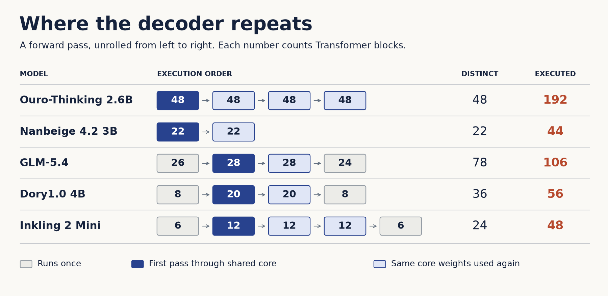

# Model architecture figures

[Overview](../README.md) · [Models and weights](models-and-weights.md) · [Research papers](research-and-code.md)

## Five released decoder designs

Ouro and Nanbeige repeat their entire decoder stacks. GLM-5.4, Dory and Inkling keep a prefix and suffix outside the loop. For example, GLM-5.4 runs layers 1–26 once, 27–54 twice, then 55–78 once. That gives 78 distinct blocks and 106 block applications per token. The diagram counts decoder blocks at the indicated settings and excludes the embedding and output head.

| Model | Pass schedule | Distinct blocks | Block applications | Architecture diagram and primary source |
| --- | --- | ---: | ---: | --- |
| Ouro-Thinking 2.6B | 48 × 4 | 48 | 192 | [Gallery diagram](https://sebastianraschka.com/llm-architecture-gallery/models/ouro-thinking-2-6b/) · [2.6B Thinking config](https://huggingface.co/ByteDance/Ouro-2.6B-Thinking/blob/main/config.json) |
| Nanbeige 4.2 3B | 22 × 2 | 22 | 44 | [Gallery diagram](https://sebastianraschka.com/llm-architecture-gallery/models/nanbeige-4-2-3b/) · [Config](https://huggingface.co/Nanbeige/Nanbeige4.2-3B/blob/main/config.json) |
| GLM-5.4 | 26 + 28 × 2 + 24 | 78 | 106 | [Gallery diagram](https://sebastianraschka.com/llm-architecture-gallery/models/glm-5-4/) · [Z.ai release](https://z.ai/blog/glm-5.4) |
| Dory1.0 4B | 8 + 20 × 2 + 8 | 36 | 56 | [Gallery diagram](https://sebastianraschka.com/llm-architecture-gallery/models/dory1-0-4b/) · [BF16 config](https://huggingface.co/nvidia/NVIDIA-Nemotron-Labs-Dory1.0-4B-BF16/blob/main/config.json) |
| Inkling 2 Mini | 6 + 12 × 3 + 6 | 24 | 48 | [Gallery diagram](https://sebastianraschka.com/llm-architecture-gallery/models/inkling-2-mini/) · [Release config](https://huggingface.co/thinkingmachines/Inkling-2-Mini/blob/main/config.json) |

Sebastian Raschka’s *LLM Architecture Gallery* provides the five detailed schematics linked above. The summary graphic unrolls their decoder schedules using one counting convention. In particular, Dory’s config counts attention and feed-forward sublayers separately: its 40 recurrent sublayers form 20 recurrent Transformer blocks. [Gallery comparison](https://sebastianraschka.com/llm-architecture-gallery/looped-depth-sharing/)

## Figures from the papers

Each image below opens the numbered figure in its paper. Start with Huginn for a single recurrent core, then compare how the update rule and stopping criterion change across models.

| Model | What to trace |
| --- | --- |
| [Huginn](#huginn) | Prelude, recurrent core and coda |
| [Ouro](#ouro) | A shared stack with an exit gate |
| [LoopUS](#loopus) | Adding a loop to a pretrained model |
| [Attractor LM](#attractor-lm) | Refining an output proposal |
| [HRM](#hrm) | Two recurrent modules at different rates |
| [Tiny Recursive Model](#tiny-recursive-model) | A latent state and a candidate answer |
| [FPRM](#fprm) | Stopping near a fixed point |
| [LoopVL](#loopvl) | Two scales of visual refinement |
| [LoopedWAM](#loopedwam) | Separate depths for vision and action |
| [Dooop](#dooop) | A shared denoiser trained from a teacher |

## Huginn

Read the blue, green and red blocks from left to right. The prelude encodes the tokens once. Each green pass receives the current latent state and the encoded input. The coda reads the final state to predict the next token. Changing the pass count changes the depth of the same checkpoint.

[Original figure 2](https://arxiv.org/html/2502.05171v2#S2.F2) · [Paper](https://arxiv.org/abs/2502.05171) · [Weight files](https://huggingface.co/tomg-group-umd/huginn-0125/tree/main)

## Ouro

Follow one position up the stack. Each pass updates its hidden state with the same layers. In training the authors attach a prediction loss at each depth. The paper describes early stopping based on accumulated exit probability. The released Hugging Face implementation runs the configured passes before choosing or weighting their outputs. [Publisher implementation](https://huggingface.co/ByteDance/Ouro-2.6B-Thinking/blob/main/modeling_ouro.py)

[Original figure 3](https://arxiv.org/html/2510.25741v5#S3.F3) · [Paper](https://arxiv.org/abs/2510.25741) · [Weight files](https://huggingface.co/ByteDance/Ouro-1.4B/tree/main)

## LoopUS

Panel (a) divides the pretrained layers into an encoder, a reasoning block and a decoder. The reasoning block is reused, with a gate between iterations. Panel (b) shows the supervision used to train the confidence signal that can end refinement.

[Original figure 2](https://arxiv.org/html/2605.11011v1#S3.F2) · [Paper](https://arxiv.org/abs/2605.11011) · [Weight files](https://huggingface.co/Thrillcrazyer/Qwen3_1.7B_LoopUS/tree/main)

## Attractor LM

The backbone makes an initial proposal. On every solver step the attractor module reads both that original proposal and the current estimate. The output head reads the final estimate when the solver converges or reaches its step limit.

[Original figure 3](https://arxiv.org/html/2605.12466v1#S3.F3) · [Paper](https://arxiv.org/abs/2605.12466) · [Weight files](https://huggingface.co/jacobfa1/attractor-770m/tree/main)

## HRM

Follow the low-level state through several updates while the high-level state is held fixed. The high-level module then reads the revised low-level state and updates its own state. Each module has its own weights, reused on its own schedule.

[Original figure 4](https://arxiv.org/html/2506.21734v3#S2.F4) · [Paper](https://arxiv.org/abs/2506.21734) · [Weight files](https://huggingface.co/sapientinc/HRM-checkpoint-ARC-2/tree/main)

## Tiny Recursive Model

Read the inner path first. A small network updates a latent state from the question, the current answer and the preceding latent. The answer update then reads the revised latent. The linked ARC checkpoints were trained by ARC Prize for independent verification.

[Original figure 1](https://arxiv.org/html/2510.04871v1#S1.F1) · [Paper](https://arxiv.org/abs/2510.04871) · [Weight files](https://huggingface.co/arcprize/trm_arc_prize_verification/tree/main)

## FPRM

The recurrent Transformer repeatedly updates the puzzle representation. Pre-normalization and residual scaling control propagation through repeated steps. The change between successive states supplies a signal for deciding when to stop.

[Original figure 3](https://arxiv.org/html/2606.18206v1#S1.F3.fig2) · [Paper](https://arxiv.org/abs/2606.18206) · [Weight files](https://huggingface.co/fixed-point-reasoners/fprm/tree/main)

## LoopVL

The vision encoder and projector supply visual positions alongside instruction tokens. In the default schedule the low-level module runs three times, then the high-level module runs once. That entire cycle runs twice. The two modules own separate weights.

[Original figure 2](https://arxiv.org/html/2609.38426v1#S2.F2) · [Paper](https://arxiv.org/abs/2609.38426) · [Weight files](https://huggingface.co/TierFlow/LoopVL/tree/main)

## LoopedWAM

The video expert reuses its core to encode the frame and caches its keys and values. At each action sampling step the action expert reuses its own core and attends to those cached features. The two experts can use different loop counts.

[Original figure 2](https://arxiv.org/html/2611.25595v2#S3.F2) · [Paper](https://arxiv.org/abs/2611.25595) · [Weight files](https://huggingface.co/anhdao69/LoopedWAM/tree/main)

## Dooop

Panel (c) unrolls the student at a single diffusion time. Each round applies the same Transformer blocks to the previous hidden state and produces an intermediate output. These depth updates occur inside a denoising step. The teacher supplies the training targets.

[Original figure 2](https://arxiv.org/html/2611.31977v1#S3.F2) · [Paper](https://arxiv.org/abs/2611.31977) · [Weight files](https://huggingface.co/ShimaRinC/Distill-to-Loop/tree/main)
