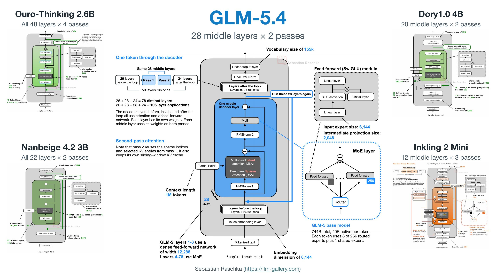
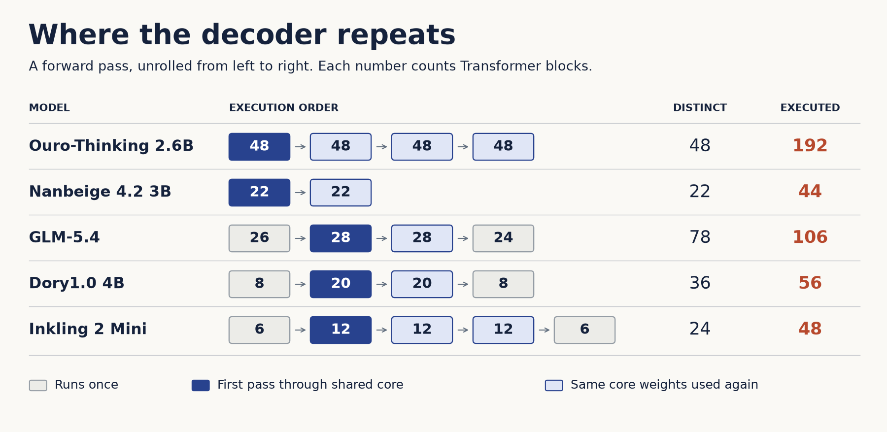

# Models and weights

**Figure source** · Sebastian Raschka, 24 November 2026. [Original post on X](https://x.com/rasbt/status/2125249956495953973) · [Full-resolution figure](https://pbs.twimg.com/media/HX5njjzXIAAYbxm?format=jpg&name=orig) · [LLM Architecture Gallery](https://sebastianraschka.com/llm-architecture-gallery/looped-depth-sharing/)

Ouro and Nanbeige repeat the full decoder stack. GLM-5.4, Dory and Inkling repeat a middle block of layers. [Per-model sources and layer counts](model-architectures.md#five-decoder-architectures)

View the five decoder schedules side by side

[Overview](../README.md) · [Architecture figures](model-architectures.md) · [Selected readings](../README.md#selected-readings) · [BibTeX](../references.bib)

Checkpoint links open the weight files or the publisher’s release directory. Each entry was checked for public weight files on 2026-11-26. The license column reports the terms the publisher gives for the weights. “Unspecified” means no weight license was identified. For adapters, the entry names the required base model.

## Contents

- [Shared-depth language models](#shared-depth-language-models)
- [Puzzle reasoning](#puzzle-reasoning)
- [Vision, action and scientific sequences](#vision-action-and-scientific-sequences)
- [Tabular classification](#tabular-classification)
- [Sequence recurrence and iterative decoding](#sequence-recurrence-and-iterative-decoding)
- [Release variants](#release-variants)
- [Research releases](#research-releases)

## Shared-depth language models

| Model family | Recurrent mechanism | Released checkpoints | Reference | Weight license |
| --- | --- | --- | --- | --- |
| ALBERT | A fixed-depth encoder with cross-layer parameter sharing. The base-v2 release is a compact reference for studying weight tying in masked language modeling. | [Base v2](https://huggingface.co/albert/albert-base-v2/tree/main) | [ALBERT](https://arxiv.org/abs/1909.11942) | Apache-2.0 |
| ARLoop | Uses attention over earlier layer states to decide what each layer reads. The authors also release a 0.6B looped baseline with standard pre-normalization for a same-size residual-design comparison. | [0.6B](https://huggingface.co/osunlp/ARLoop-0.6B/tree/main) · [0.6B baseline](https://huggingface.co/osunlp/ARLoop-baseline-0.6B/tree/main) · [1.2B](https://huggingface.co/osunlp/ARLoop-1.2B/tree/main) | [ARLoop report](https://arxiv.org/abs/2611.05234) | Apache-2.0 |
| [Attractor LM](model-architectures.md#attractor-lm) | A language backbone proposes an output state. A second, shared module refines it toward equilibrium, conditioned on that initial proposal. | [770M](https://huggingface.co/jacobfa1/attractor-770m/tree/main) | [Paper](https://arxiv.org/abs/2605.12466) | MIT |
| Concertina-2.27B | Each pair of adjacent layers in Qwen3-4B becomes one block run twice, with token-gated low-rank corrections. The distilled student runs on its own with the custom Transformers code included in the release. | [2.27B student](https://huggingface.co/myboker/Concertina-2.27B/tree/main) | [Paper](https://arxiv.org/abs/2611.18113) · [Loading example](https://huggingface.co/myboker/Concertina-2.27B) | Apache-2.0 |
| DEQ-Transformer | A fixed-point solver repeatedly applies a shared self-attention transformation until it reaches an equilibrium or its iteration limit. The authors released the full word-level language model trained on WikiText-103. | [pretrained_wt103_deqtrans_v3.pkl](https://drive.google.com/file/d/1lZx_sHt0-1gJVgXx90LDRizq3k-ZI0SW/view) | [Deep Equilibrium Models](https://arxiv.org/abs/1909.01377) · [Release and evaluation instructions](https://github.com/locuslab/deq/tree/master/DEQ-Sequence#pre-trained-models) | Unspecified |
| [Dory 1.0](model-architectures.md#five-decoder-architectures) | The BF16 checkpoint runs eight prefix blocks, 20 shared blocks twice (`n_recurrent_loops=2`), then eight suffix blocks. The default `recurrent_kv_cache_mode=per_loop` keeps a separate KV cache for each pass. Set it to `last_loop` to keep one cache per recurrent attention layer. | [4B BF16](https://huggingface.co/nvidia/NVIDIA-Nemotron-Labs-Dory1.0-4B-BF16/tree/main) · [4B NVFP4](https://huggingface.co/nvidia/NVIDIA-Nemotron-Labs-Dory1.0-4B-NVFP4/tree/main) · [MXFP8](https://huggingface.co/nvidia/NVIDIA-Nemotron-Labs-Dory1.0-4B-MXFP8/tree/main) · [GGUF](https://huggingface.co/nvidia/NVIDIA-Nemotron-Labs-Dory1.0-4B-GGUF/tree/main) | [Dory report](https://arxiv.org/abs/2611.03998) · [BF16 config](https://huggingface.co/nvidia/NVIDIA-Nemotron-Labs-Dory1.0-4B-BF16/blob/main/config.json) · [KV cache settings](https://huggingface.co/nvidia/NVIDIA-Nemotron-Labs-Dory1.0-4B-BF16#reducing-the-kv-cache-memory-overhead) | OpenMDW-1.1 |
| Gated Recurrent Transformer (GRT) | A gate blends the previous state with a shared core update between a fixed prelude and coda. Releases include compute-matched and parameter-matched training configurations. | [large-isoflop](https://huggingface.co/Amr-Hegazy/grt-large-isoflop/tree/main) · [large-isoparam](https://huggingface.co/Amr-Hegazy/grt-large-isoparam/tree/main) · [medium-isoflop](https://huggingface.co/Amr-Hegazy/grt-medium-isoflop/tree/main) · [medium-isoparam](https://huggingface.co/Amr-Hegazy/grt-medium-isoparam/tree/main) | [Paper](https://arxiv.org/abs/2608.15062) | CC-BY-4.0 |
| HRM-Text | Applies fast and slow recurrent modules to text generation. This release uses a task-completion objective on instruction–response pairs. | [1B original release](https://huggingface.co/sapientinc/HRM-Text-1B/tree/main) | [HRM-Text report](https://arxiv.org/abs/2605.20613) | Apache-2.0 |
| [Huginn](model-architectures.md#huginn) | A 3.5B language model with a recurrent core between distinct input and output stacks. The same checkpoint supports different recurrence counts at inference. | [Huginn-0125](https://huggingface.co/tomg-group-umd/huginn-0125/tree/main) | [Recurrent depth report](https://arxiv.org/abs/2502.05171) | Apache-2.0 |
| [Inkling 2 Mini](model-architectures.md#five-decoder-architectures) | Runs six prefix blocks once, twelve shared middle blocks three times and six suffix blocks once. A separate research checkpoint supports experiments that vary the pass count. | [Inkling 2 Mini](https://huggingface.co/thinkingmachines/Inkling-2-Mini/tree/main) · [Variable-loop research checkpoint](https://huggingface.co/thinkingmachines/TML-d24-varloop-research/tree/main) | [Thinking Machines Lab release](https://thinkingmachines.ai/news/inkling-2-mini/) | Apache-2.0 |
| LatentLoop | The two middle passes share mixture-of-experts weights and have separate attention parameters. The first pass processes a compressed sequence, then its update feeds the full-length second pass. Each folder holds a separately trained model for the authors’ PyTorch loader. | [1.3B](https://huggingface.co/yhx12/LatentLoop/tree/main/1.3B-40B) · [3B](https://huggingface.co/yhx12/LatentLoop/tree/main/3B-70B) · [7B](https://huggingface.co/yhx12/LatentLoop/tree/main/7B-140B) | [Paper](https://arxiv.org/abs/2610.19975) · [Loading example](https://huggingface.co/yhx12/LatentLoop#load-and-generate) | Apache-2.0 |
| LatentMT | Each translation direction has its own LoRA adapter. Load it on [ByteDance/Ouro-2.6B-Thinking](https://huggingface.co/ByteDance/Ouro-2.6B-Thinking) and run four recurrent passes. | [English → Simplified Chinese adapter](https://huggingface.co/wrchen1/LatentMT-2.6B-eng-latn-zho-hans/tree/main) · [All 32 translation directions](https://huggingface.co/collections/wrchen1/latentmt-6a8b943b0e9b48dcb43f3e9c) | [Paper](https://arxiv.org/abs/2607.18618) · [Model card and loading example](https://huggingface.co/wrchen1/LatentMT-2.6B-eng-latn-zho-hans) | Apache-2.0 (adapter) |
| LEV | Scores the answer options after each pass through a looped backbone. Each release contains an adapter and decision head to use with its base model. | [1.4B adapter](https://huggingface.co/songdj/Lev-1.4B/tree/main) · [2.6B adapter](https://huggingface.co/songdj/Lev-2.6B/tree/main) · [3B adapter](https://huggingface.co/songdj/Lev-3B/tree/main) | [Paper](https://arxiv.org/abs/2610.20951) | Apache-2.0 |
| LOTUS | Shared passes refine padded latent reasoning positions in parallel. `from_pretrained` loads the weights. The authors’ GSM8K script runs the loop with `--n_looped_iters 6`. Use `--c_thought 25` for the standard and CODI checkpoints or `--c_thought 50` for the natural-language variant to set the number of tokens per latent block. | [GSM-LLaMA 3B](https://huggingface.co/yingfanbot/gsm-lotus-llama3b/tree/main) · [CODI variant](https://huggingface.co/yingfanbot/gsm-lotus-llama3b-codi/tree/main) · [Natural-language variant](https://huggingface.co/yingfanbot/gsm-lotus-llama3b-nl/tree/main) | [Paper](https://arxiv.org/abs/2606.31779) · [Evaluation script](https://github.com/yingfan-bot/lotus/blob/main/scripts/eval.py) · [GSM8K command](https://huggingface.co/yingfanbot/gsm-lotus-llama3b#reproduce-the-number-above) | MIT |
| LoopCoder-v2 | A 7B instruction-tuned coding model. The downloadable variant runs its 14 shared layers twice. | [7B two-loop checkpoint](https://huggingface.co/Multilingual-Multimodal-NLP/LoopCoder-V2/tree/main) | [Loop-count study](https://arxiv.org/abs/2606.18023) | Apache-2.0 |
| LoopFormer | Three models pair different block counts and iteration counts for the same nominal depth of 24. Shortcut modulation allows shorter inference trajectories. | [1 × 24](https://huggingface.co/armenjeddi/LoopFormer-1block-24iterations/tree/main) · [2 × 12](https://huggingface.co/armenjeddi/LoopFormer-2block-12iterations/tree/main) · [3 × 8](https://huggingface.co/armenjeddi/LoopFormer-3block-8iterations/tree/main) | [LoopFormer paper](https://arxiv.org/abs/2602.11451) | Unspecified |
| LoopRes | Looped layers attend to a window of their own outputs from earlier passes when adapting a pretrained language model. | [Qwen3-1.7B](https://huggingface.co/oahzxl/LoopRes-Qwen3-1.7B/tree/main) | [Paper](https://arxiv.org/abs/2611.31094) | MIT |
| [LoopUS](model-architectures.md#loopus) | Converts Qwen3 into an encoder, shared reasoning block, and decoder. A confidence head can terminate the recurrent stage early. | [Qwen3-1.7B retrofit](https://huggingface.co/Thrillcrazyer/Qwen3_1.7B_LoopUS/tree/main) | [LoopUS paper](https://arxiv.org/abs/2605.11011) | Apache-2.0 |
| Looped GPT-BERT | The BabyLM Strict-small release traverses four shared layers twelve times. It combines causal and masked next-token training. | [4 layers × 12 passes](https://huggingface.co/Survivor613/BabyLM2026-Strict-Small-looped_GPT-BERT/tree/main) | [Paper](https://arxiv.org/abs/2609.09691) | Unspecified |
| Metis-1.6 | Praxis and Logos each run a hybrid Mamba-2 and attention mixture-of-experts stack twice per token. | [Logos](https://huggingface.co/Lernex/Metis-1.6-Logos/tree/main) · [Praxis-Base](https://huggingface.co/Lernex/Metis-1.6-Praxis-Base/tree/main) · [Logos-Base](https://huggingface.co/Lernex/Metis-1.6-Logos-Base/tree/main) · [Praxis](https://huggingface.co/Lernex/Metis-1.6-Praxis/tree/main) · [Precision variants](#metis-16) | [Paper](https://arxiv.org/abs/2610.37903) | Apache-2.0 |
| Mixture-of-Recursions (MoR) | A router selects which tokens continue through the shared block. Compare expert-choice and token-choice routing at a maximum depth of three against the fixed-depth recursive model and the vanilla Transformer from the same experiment series. | [Expert-choice ×3](https://drive.google.com/drive/folders/1HhTWzo9lBrSHcljPBOUch3C0bz5O5s39) · [Token-choice ×3](https://drive.google.com/drive/folders/1F08AjAigrmjzpb981AAvJakjQt-UTCCV) · [Fixed ×3](https://drive.google.com/drive/folders/1JJuWZ1BWdXSEsSoU0AEr9GV-p3XMvuIo) · [Vanilla](https://drive.google.com/drive/folders/1t1TmKA05PY1bGQHrbkxz8yPiU1EiExaB) · [All nine checkpoints](https://drive.google.com/drive/folders/1pYKJOu2aBGC-jgoWbfP6T_vqEYtUVxa4) | [Paper](https://arxiv.org/abs/2507.10524) · [Checkpoint guide](https://github.com/raymin0223/mixture_of_recursions#-pretrained-checkpoints) | Unspecified |
| [Nanbeige4.2](model-architectures.md#five-decoder-architectures) | The 3B model runs all 22 shared layers twice. The report covers the base model and post-training for tool use and coding. The reported 3B count excludes embeddings. | [3B base](https://huggingface.co/Nanbeige/Nanbeige4.2-3B-Base/tree/main) · [3B post-trained](https://huggingface.co/Nanbeige/Nanbeige4.2-3B/tree/main) | [Nanbeige4.2 technical report](https://arxiv.org/abs/2607.22083) | Apache-2.0 |
| OrbitLM-1.8B-Thinking | The released bilingual model runs the same 24 Ouro-style layers four times per token. It was pretrained from scratch on English and Russian text, then fine-tuned with supervised examples and GRPO. | [1.8B Thinking](https://huggingface.co/ai-forever/OrbitLM-1.8B-Thinking/tree/main) | [Training study](https://arxiv.org/abs/2610.00673) · [Released model and training recipe](https://huggingface.co/ai-forever/OrbitLM-1.8B-Thinking) | Apache-2.0 |
| [Ouro](model-architectures.md#ouro) | The 2.6B Thinking config runs 48 shared layers four times. The released implementation computes gate scores at each pass. | [1.4B base](https://huggingface.co/ByteDance/Ouro-1.4B/tree/main) · [1.4B Thinking](https://huggingface.co/ByteDance/Ouro-1.4B-Thinking/tree/main) · [2.6B base](https://huggingface.co/ByteDance/Ouro-2.6B/tree/main) · [2.6B Thinking](https://huggingface.co/ByteDance/Ouro-2.6B-Thinking/tree/main) | [Ouro report](https://arxiv.org/abs/2510.25741) | Apache-2.0 |
| Parcae | The recurrent block mixes the encoded input with the current state under a constraint that limits amplification across passes. The four model sizes support depth sweeps at a fixed parameter count. Load them with `parcae_lm.from_pretrained`. | [140M](https://huggingface.co/SandyResearch/parcae-140m/tree/main) · [370M](https://huggingface.co/SandyResearch/parcae-370m/tree/main) · [770M](https://huggingface.co/SandyResearch/parcae-770m/tree/main) · [1.3B](https://huggingface.co/SandyResearch/parcae-1.3b/tree/main) | [Paper](https://arxiv.org/abs/2604.12946) · [Loader](https://github.com/sandyresearch/parcae#models) | Unspecified |
| Retrofitted TinyLlama | Two conversions of the same pretrained backbone with different target training recurrence counts. These are separately trained models. | [4 recurrences](https://huggingface.co/smcleish/Recurrent-TinyLlama-3T-train-recurrence-4/tree/main) · [32 recurrences](https://huggingface.co/smcleish/Recurrent-TinyLlama-3T-train-recurrence-32/tree/main) · [All backbones and controls](#retrofitted-language-models) | [Retrofitting study](https://arxiv.org/abs/2511.07384) | Apache-2.0 |
| Think-at-Hard / TaH2 | A learned decision module selects tokens for another pass. The TaH2 two-pass release includes the 1.7B backbone, an input updater and the decision module. Compare it with the single-pass TaH2 control using the authors’ inference code. | [TaH-plus 1.7B](https://huggingface.co/nics-efc/TaH-plus-1.7B/tree/main) · [TaH2 at most two passes](https://huggingface.co/nics-efc/TaH2-1.7B-max2/tree/main) · [TaH2 single-pass control](https://huggingface.co/nics-efc/TaH2-1.7B-Standard/tree/main) | [TaH](https://arxiv.org/abs/2511.08577) · [TaH2](https://arxiv.org/abs/2609.35748) · [Inference code](https://github.com/thu-nics/TaH) | Apache-2.0 |
| Towards Looped Models Done Right | Part I compares loop placement, input injection and recurrent state design. Part II varies the training depth distribution and how the input is reinjected. The authors’ xLLM loader reads all 49 checkpoints, including baselines and distilled students. | [Part I dense Huginn](https://huggingface.co/IFM/LoopedLM-P1-dense-huginn-336b/tree/main) · [Part II learned depth prior](https://huggingface.co/IFM/LoopedLM-P2-huginn-m-learned-entropy0p01/tree/main) · [All 49 checkpoints](https://huggingface.co/collections/IFM/towards-looped-models-done-right) | [Part I](https://arxiv.org/abs/2610.23036) · [Part II](https://arxiv.org/abs/2610.06833) · [xLLM loader and manifest](https://github.com/ifm-ai/xllm-loop#checkpoints) | Apache-2.0 |

## Puzzle reasoning

| Model family | Recurrent mechanism | Released checkpoints | Reference | Weight license |
| --- | --- | --- | --- | --- |
| Equilibrium Reasoners (EqR) | Iterates a recurrent solver toward a puzzle solution. The implementation supports attention and MLP variants. | [Maze and Sudoku](https://huggingface.co/locuslab/EqR-model/tree/main) | [Paper](https://arxiv.org/abs/2605.21488) | Unspecified |
| [FPRM](model-architectures.md#fprm) | A shared Transformer update refines a puzzle state. The model uses convergence as its halting signal. | [ARC, maze and Sudoku checkpoints](https://huggingface.co/fixed-point-reasoners/fprm/tree/main) | [Paper](https://arxiv.org/abs/2606.18206) | MIT |
| [HRM](model-architectures.md#hrm) | Two recurrent attention modules run at different rates. Each task has its own checkpoint; the files are named `checkpoint`. | [ARC-AGI-2](https://huggingface.co/sapientinc/HRM-checkpoint-ARC-2/tree/main) · [Sudoku Extreme](https://huggingface.co/sapientinc/HRM-checkpoint-sudoku-extreme/tree/main) · [Maze-Hard](https://huggingface.co/sapientinc/HRM-checkpoint-maze-30x30-hard/tree/main) | [HRM paper](https://arxiv.org/abs/2506.21734) | Unspecified |
| Input-Conditioned Search (ICS) | An inference procedure for recurrent puzzle solvers. Changing the input condition gives the same state a different update trajectory. The release includes task-specific solver weights. | [Solver checkpoints](https://huggingface.co/hcshi/ICS/tree/main) | [Paper](https://arxiv.org/abs/2610.18547) | MIT |
| [Tiny Recursive Model (TRM)](model-architectures.md#tiny-recursive-model) | A small shared network alternates latent refinement and answer updates. ARC Prize independently trained and released the ARC evaluation checkpoints using the authors’ recipe. | [ARC Prize verification weights](https://huggingface.co/arcprize/trm_arc_prize_verification/tree/main) | [Paper](https://arxiv.org/abs/2510.04871) | MIT |

## Vision, action and scientific sequences

| Model family | Recurrent mechanism | Released checkpoints | Reference | Weight license |
| --- | --- | --- | --- | --- |
| AdaLoop | Uses the question to condition further passes through a frozen vision encoder. The release includes base-model files and adaptation weights. | [Vision-language adapters and bases](https://huggingface.co/Lyy0725/AdaLoop/tree/main) | [Paper](https://arxiv.org/abs/2610.21323) | Base-model terms |
| Déjà View | Repeats a decoder block on multi-view image features to refine a 3D reconstruction. | [Multi-view reconstruction](https://huggingface.co/nvidia/dvlt/tree/main) | [Paper](https://arxiv.org/abs/2605.30215) | NVIDIA OneWay Noncommercial |
| [Dooop](model-architectures.md#dooop) | Distills a diffusion Transformer into a student whose shared block produces a supervised output at each depth. The hub contains the looped diffusion components. | [SD3 Medium and Turbo](https://huggingface.co/ShimaRinC/Distill-to-Loop/tree/main) | [Paper](https://arxiv.org/abs/2611.31977) | Stability AI Non-Commercial Research Community |
| Jina-OCR-v1 | A shared draft block predicts three future positions for speculative decoding. The OCR decoder verifies the draft. | [OCR model and FastMTP head](https://huggingface.co/jinaai/jina-ocr-v1/tree/main) | [Paper](https://arxiv.org/abs/2609.03181) | CC-BY-NC-4.0 |
| Looped-DiT | Reapplies Transformer blocks within a diffusion denoising step. Loop count and sampling steps control different parts of generation. | [B/16](https://huggingface.co/sensenova/Looped-DiT-B16/tree/main) · [B/32](https://huggingface.co/sensenova/Looped-DiT-B32/tree/main) | [Paper](https://arxiv.org/abs/2609.40305) | MIT |
| [LoopVL](model-architectures.md#loopvl) | Refines a joint vision–language state through module-level and model-level loops. The authors expose the two recurrence counts for inference. | [LoopVL-1B](https://huggingface.co/TierFlow/LoopVL/tree/main) | [LoopVL paper](https://arxiv.org/abs/2609.38426) | Unspecified |
| [LoopedWAM](model-architectures.md#loopedwam) | The video and action experts each reuse a core. The action expert can take a different number of passes while reading cached video features. | [Task-specific policies and elastic variants](https://huggingface.co/anhdao69/LoopedWAM/tree/main) | [Paper](https://arxiv.org/abs/2611.25595) | Apache-2.0 |
| RD-VLA | Repeats a weight-tied Transformer in the action head. Each file tree includes the action head and its associated model components for one LIBERO evaluation suite. | [Spatial, 40k steps](https://huggingface.co/hqfang/12_24-24_24_Spatial_40k/tree/main) · [Long, 75k steps](https://huggingface.co/hqfang/12_24-24_24_Long_75k/tree/main) | [RD-VLA paper](https://arxiv.org/abs/2602.07845) | Apache-2.0 |
| recAMPLIFY | A masked protein language model applies a weight-tied Transformer core to residue representations for a configurable number of cycles. | [Recurrent, gated and baseline variants](https://huggingface.co/chandar-lab/recamplify/tree/main) | [Paper](https://arxiv.org/abs/2610.26747) | MIT |
| [Solv3R](model-architectures.md#solv3r) | One shared solver updates the state of each camera view using features from across the scene. It can continue refining the same images or incorporate new views before predicting depth and camera poses. | [117M reconstruction model](https://huggingface.co/jgkwak/solv3r/tree/main) | [Paper](https://arxiv.org/abs/2611.02857) · [Inference code](https://github.com/ubc-vision/solv3r) | [NVIDIA License (non-commercial)](https://huggingface.co/jgkwak/solv3r/blob/main/LICENSE) |

## Tabular classification

| Model family | Recurrent mechanism | Released checkpoints | Reference | Weight license |
| --- | --- | --- | --- | --- |
| LoopICL | A shared Transformer block refines cell and row representations for in-context classification. Compare a fixed pass budget with a learned early-exit gate using the two full classifier checkpoints (about 6.6 MB each). | [Standard classifier](https://github.com/amirbalef/loopicl/blob/main/src/loopicl/weights/loopicl-cls-stage2-step-30000.ckpt) · [Early-exit classifier](https://github.com/amirbalef/loopicl/blob/main/src/loopicl/weights/loopicl-cls-ee-step-4000.ckpt) | [Paper](https://arxiv.org/abs/2609.36108) · [Inference example](https://github.com/amirbalef/loopicl/blob/main/notebooks/classification_example.ipynb) | Unspecified |

## Sequence recurrence and iterative decoding

| Model family | Recurrent mechanism | Released checkpoints | Reference | Weight license |
| --- | --- | --- | --- | --- |
| ALoDLM | Within each denoising step, unresolved positions carry their latent states through more shared passes. Committed tokens become context. Both releases include backbone weights and the learned exit gate (`exit_gate.pt`) for the authors’ decoder. | [1.7B](https://huggingface.co/amazon/ALoDLM-1.7B/tree/main) · [8B](https://huggingface.co/amazon/ALoDLM-8B/tree/main) | [Paper](https://arxiv.org/abs/2610.04198) · [Decoder](https://github.com/amazon-science/ALoDLM) | CC-BY-NC-4.0 |
| Latent Feedback | Each token passes its top-layer state to the next token’s input. The linked 134M runs compare feedback with a plain Transformer at the same unique-data and training-compute budgets. Use the LoRM code to load each `checkpoint.pt`. | [134M feedback](https://huggingface.co/IFM/latent-feedback-checkpoints/tree/main/feedback-134m-u100-f1) · [134M matched control](https://huggingface.co/IFM/latent-feedback-checkpoints/tree/main/transformer-134m-u100-f1) | [Paper](https://arxiv.org/abs/2611.20404) · [LoRM experiments](https://github.com/ifm-ai/LoRM/tree/main/works/latent_feedback) | Apache-2.0 |
| LLaDA | Repeatedly fills masked response positions conditioned on the prompt. | [8B Instruct](https://huggingface.co/GSAI-ML/LLaDA-8B-Instruct/tree/main) | [LLaDA](https://arxiv.org/abs/2502.09992) | MIT |
| Looped UDLM | Repeats early Transformer layers during a denoising step of a uniform diffusion language model. The release includes looped and baseline training runs. | [OpenWebText checkpoints](https://huggingface.co/saitejautpala/looped_udlm/tree/main) | [Paper](https://arxiv.org/abs/2610.30066) | Apache-2.0 |
| Mamba | Updates a selective state-space representation as the sequence advances. | [130M base, original format](https://huggingface.co/state-spaces/mamba-130m/tree/main) | [Mamba](https://arxiv.org/abs/2312.00752) | Apache-2.0 |
| MDLM | Repeatedly denoises a partially masked sequence. | [OpenWebText checkpoint](https://huggingface.co/kuleshov-group/mdlm-owt/tree/main) | [MDLM](https://arxiv.org/abs/2406.07524) | Apache-2.0 |
| RWKV-4 | Updates the recurrent state once per input token. | [169M Pile](https://huggingface.co/RWKV/rwkv-4-169m-pile/tree/main) | [RWKV](https://arxiv.org/abs/2305.13048) | Unspecified |
| URCHIN | A spiking language model recirculates the current token’s activity through a lateral network across multiple transmissions. | [BabyLM multilingual](https://huggingface.co/URCHINBABY/URCHIN_BabyLM2026_Multilingual/tree/main) | [Paper](https://arxiv.org/abs/2609.13899) | CC-BY-NC-4.0 |

## Release variants

### Retrofitted language models

The study publishes separately trained depth targets and untrained conversion controls. The non-recurrent checkpoint is a post-training baseline. [Paper](https://arxiv.org/abs/2511.07384) · [Publisher collection](https://huggingface.co/collections/tomg-group-umd/retrofitting-recurrence)

- **Llama-3.2** · [R = 32](https://huggingface.co/smcleish/Recurrent-Llama-3.2-train-recurrence-32/tree/main) · [R = 16](https://huggingface.co/smcleish/Recurrent-Llama-3.2-train-recurrence-16/tree/main) · [R = 8](https://huggingface.co/smcleish/Recurrent-Llama-3.2-train-recurrence-8/tree/main) · [R = 4](https://huggingface.co/smcleish/Recurrent-Llama-3.2-train-recurrence-4/tree/main) · [untrained control](https://huggingface.co/smcleish/Recurrent-Llama-3.2-untrained/tree/main) · [2-4-2-untrained control](https://huggingface.co/smcleish/Recurrent-Llama-3.2-2-4-2-untrained/tree/main)
- **TinyLlama-3T** · [R = 32](https://huggingface.co/smcleish/Recurrent-TinyLlama-3T-train-recurrence-32/tree/main) · [R = 16](https://huggingface.co/smcleish/Recurrent-TinyLlama-3T-train-recurrence-16/tree/main) · [R = 8](https://huggingface.co/smcleish/Recurrent-TinyLlama-3T-train-recurrence-8/tree/main) · [R = 4](https://huggingface.co/smcleish/Recurrent-TinyLlama-3T-train-recurrence-4/tree/main) · [R = 4-single-phase](https://huggingface.co/smcleish/Recurrent-TinyLlama-3T-train-recurrence-4-single-phase/tree/main) · [R = 4-two-phase](https://huggingface.co/smcleish/Recurrent-TinyLlama-3T-train-recurrence-4-two-phase/tree/main) · [untrained control](https://huggingface.co/smcleish/Recurrent-TinyLlama-3T-untrained/tree/main)
- **OLMo-2-0425** · [R = 32](https://huggingface.co/smcleish/Recurrent-OLMo-2-0425-train-recurrence-32/tree/main) · [R = 16](https://huggingface.co/smcleish/Recurrent-OLMo-2-0425-train-recurrence-16/tree/main) · [R = 8](https://huggingface.co/smcleish/Recurrent-OLMo-2-0425-train-recurrence-8/tree/main) · [R = 4](https://huggingface.co/smcleish/Recurrent-OLMo-2-0425-train-recurrence-4/tree/main) · [untrained control](https://huggingface.co/smcleish/Recurrent-OLMo-2-0425-untrained/tree/main)
- **Comparison** · [Non-recurrent Llama 3.2](https://huggingface.co/smcleish/Llama-3.2-non-recurrent-posttrained/tree/main)

### Metis-1.6

The publisher provides two model sizes and several inference formats. The following links open the weight files.

- **Praxis** · [NVFP4](https://huggingface.co/Lernex/Metis-1.6-Praxis-NVFP4/tree/main) · [FP8](https://huggingface.co/Lernex/Metis-1.6-Praxis-FP8/tree/main) · [MLX-4bit](https://huggingface.co/Lernex/Metis-1.6-Praxis-MLX-4bit/tree/main) · [MLX-8bit](https://huggingface.co/Lernex/Metis-1.6-Praxis-MLX-8bit/tree/main) · [GGUF](https://huggingface.co/Lernex/Metis-1.6-Praxis-GGUF/tree/main)
- **Logos** · [NVFP4](https://huggingface.co/Lernex/Metis-1.6-Logos-NVFP4/tree/main) · [FP8](https://huggingface.co/Lernex/Metis-1.6-Logos-FP8/tree/main) · [MLX-4bit](https://huggingface.co/Lernex/Metis-1.6-Logos-MLX-4bit/tree/main) · [MLX-8bit](https://huggingface.co/Lernex/Metis-1.6-Logos-MLX-8bit/tree/main) · [GGUF](https://huggingface.co/Lernex/Metis-1.6-Logos-GGUF/tree/main)

## Research releases

**GLM-5.4.** Z.ai reports converting the pretrained GLM-5 backbone through continued training. The middle 28 decoder layers run twice. Z.ai announced plans to release the weights after safety hardening. As of 2026-11-26, no public checkpoint was listed in its Hugging Face organization. [Architecture comparison](model-architectures.md#five-decoder-architectures) · [Z.ai release](https://z.ai/blog/glm-5.4) · [Publisher model hub](https://huggingface.co/zai-org)

Two papers in the [Awesome-Loop-Models catalog snapshot](https://github.com/huskydoge/Awesome-Loop-Models/tree/3cf1c6b33fc7887a177f0ce0b463e4ea77298d79/catalog) identify releases for which public weight files could not be verified on 2026-11-26. Their author resources are indexed here.

- **Late Entry** skips the initial passes for newly drafted tokens and uses a deep context cache. The authors list five Ouro and Huginn variants, including matched early-exit controls. [Paper](https://arxiv.org/abs/2611.24576) · [Author checkpoint list](https://github.com/Xalp/LateComer#released-checkpoints-hugging-face-collection)
- **GatedLoop** compares training schedules for repeated blocks with learned residual gates. The authors document the fixed and sampled loop-count runs and how their checkpoints are laid out. [Paper](https://arxiv.org/abs/2611.29704) · [Author repository](https://github.com/kvoyager/gatedloop-transformer)
